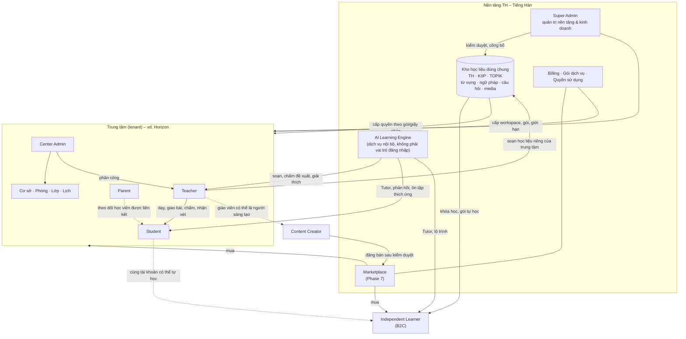
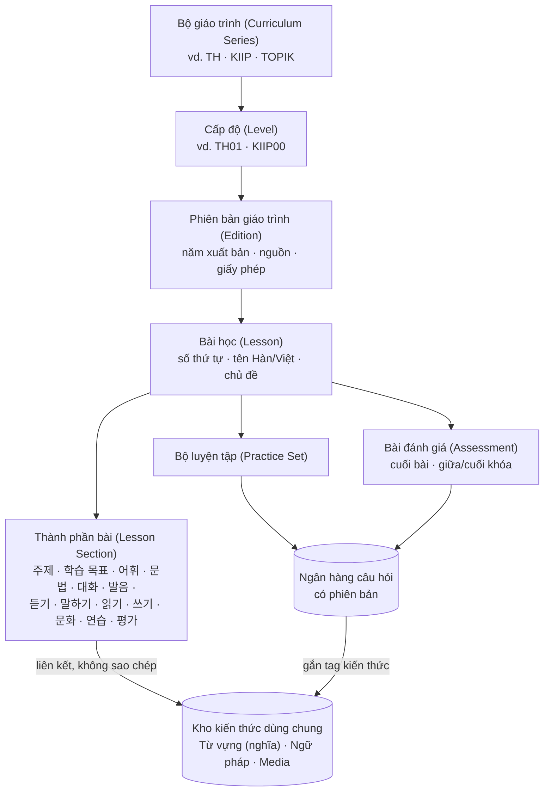
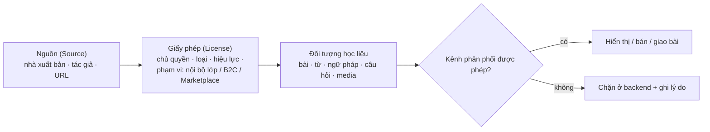

# 01 · Product Blueprint – TH – Tiếng Hàn

> Trạng thái: cập nhật theo phê duyệt 2026-11-25 (xem [07 §1](07-decisions-pending.md#1-đã-phê-duyệt)) · Liên quan: [02 Sitemap](02-sitemap.md) · [03 User Flow](03-user-flow.md) · [07 Quyết định](07-decisions-pending.md)

---

## 1. Kết quả kiểm tra repository

| Hạng mục | Kết quả |
|---|---|
| Mã nguồn | **Không có.** Repository chỉ có `.gitignore` (gợi ý Node/Next.js) và thư mục `docs/` |
| Lịch sử git | 1 commit: `docs: Phase 1 discovery & requirement analysis` (bộ tài liệu Homework Management System – nay đã chuyển vào `docs/archive/`) |
| Remote | Không cấu hình remote — phương án GitHub Private ở [09](09-github-repository-plan.md) |
| Stack hiện có | Không có. Tài liệu trước đề xuất Next.js + NestJS + PostgreSQL/Prisma + Redis/BullMQ + S3 |
| Dữ liệu giáo trình | **Không có** trong repository; không truy cập được giáo trình TH hay KIIP |
| Thông tin Horizon | Không có (số cơ sở, lớp, học viên, quy trình hiện tại) |

**Kết luận:** dự án greenfield. Kiến trúc đề xuất ở [04](04-system-architecture.md) giữ hướng của tài liệu trước (cùng khớp gợi ý trong Master Prompt §7.4) để tận dụng phân tích đã có.

---

## 2. Tóm tắt sản phẩm

**TH – Tiếng Hàn** là một nền tảng học, dạy, quản lý đào tạo và đánh giá năng lực tiếng Hàn tích hợp AI. Sản phẩm chạy trên **một nền tảng duy nhất** với một hệ thống tài khoản và một kho học liệu dùng chung có kiểm soát quyền, phục vụ đồng thời ba mô hình:

| Mô hình | Khách hàng | Giá trị chính | Phase |
|---|---|---|---|
| **B2B** | Trung tâm tiếng Hàn (Horizon là đơn vị đầu tiên) | Vận hành lớp, lịch, điểm danh, giao/chấm bài, báo cáo chất lượng, cổng phụ huynh | 1–4 (MVP) |
| **B2B2C** | Học viên trung tâm học thêm online | Học liệu số theo giáo trình lớp đang học, luyện tập, AI phản hồi | 2–5 |
| **B2C** | Người tự học | Lộ trình cá nhân, khóa học, TOPIK/KIIP, AI Tutor | 5–6 |
| **Marketplace** | Giáo viên/người sáng tạo nội dung | Bán học liệu, chia sẻ doanh thu | 7 |

### 2.1 Vấn đề cần giải quyết theo từng đối tượng

| Đối tượng | Vấn đề hiện tại (giả định điển hình) | Sản phẩm phải làm được |
|---|---|---|
| Trung tâm | Lịch, điểm danh, bài tập rời rạc (giấy, Zalo, Excel); khó biết lớp nào chậm tiến độ | Một dashboard trả lời: hôm nay lớp nào học, ai vắng, lớp nào chưa giao bài, lớp nào trễ giáo trình |
| Giáo viên | Mất thời gian soạn đề, giao bài, chấm tay, nhắc học viên | Soạn từ kho học liệu theo bài giáo trình, AI hỗ trợ soạn/chấm, chấm tự động phần xác định |
| Học viên | Không biết hôm nay cần học gì; ôn từ vựng không có hệ thống | Trang chủ "hôm nay cần làm gì", spaced repetition, sổ tay lỗi |
| Phụ huynh | Không biết con có đi học, có làm bài không | Mobile-first: lịch, điểm danh, tình trạng bài tập, điểm đã công bố |
| Người tự học | Học liệu rời rạc, không có lộ trình theo trình độ | Đánh giá đầu vào, lộ trình, AI Tutor bám giáo trình |

---

## 3. Nguyên tắc sản phẩm

Các nguyên tắc rút ra từ Master Prompt — dùng làm tiêu chí khi phải đánh đổi:

1. **Một nền tảng, nhiều ngữ cảnh.** Không tách website theo B2B/B2C. Khác biệt nằm ở *ngữ cảnh* (trung tâm/lớp/tự học) và *quyền*, không nằm ở sản phẩm.
2. **Dữ liệu thật, không giả.** Không mock data, nút giả, API giả để che chức năng chưa có. Chỉ hiển thị chức năng đã triển khai và được cấp quyền.
3. **Giáo trình là xương sống.** Mọi nội dung, bài tập, tiến độ, AI đều gắn với *giáo trình → cấp độ → phiên bản → bài*. Không hardcode mục lục.
4. **Con người quyết định điểm chính thức.** AI đề xuất; giáo viên duyệt và công bố. Phản hồi tức thời khi tự luyện được gắn nhãn khác điểm chính thức.
5. **Không suy diễn năng lực khi thiếu dữ liệu.** Không tạo điểm năng lực, không để AI "tổng hợp" vượt dữ liệu thực tế.
6. **Lịch sử là bất biến.** Bài nộp, điểm, điểm danh, phiên bản đề không bị ghi đè; thay đổi tạo bản ghi mới có người sửa, thời điểm, lý do.
7. **Bản quyền trước, số hóa sau.** Học liệu chỉ được số hóa và phân phối trong phạm vi quyền sử dụng đã ghi nhận.
8. **Mobile first cho học viên/phụ huynh; desktop first cho quản trị, soạn học liệu, chấm bài.**
9. **Làm hẹp, làm thật.** Phase nào xong phase đó, đạt tiêu chí nghiệm thu rồi mới mở rộng.

---

## 4. Sơ đồ hệ sinh thái



### 4.1 Bảy nhóm người dùng – phạm vi và giới hạn

| Vai trò | Phạm vi dữ liệu | Được làm | Không được làm | Phase |
|---|---|---|---|---|
| **Super Admin** | Toàn nền tảng | Tạo trung tâm, gói, kho học liệu chung, kiểm duyệt, cấu hình AI, xem doanh thu/chi phí | Sửa điểm học viên của trung tâm; xem dữ liệu học viên ngoài mục đích hỗ trợ (phải có audit) | 1 |
| **Center Admin** | Một trung tâm (có thể giới hạn theo cơ sở) | Cơ sở, lớp, giáo viên, học viên, phụ huynh, lịch, điểm danh, báo cáo, học phí | Truy cập trung tâm khác; mặc định không sửa điểm (D-B09) | 1 |
| **Teacher** | Lớp được phân công trong trung tâm | Buổi học, điểm danh, học liệu, giao/chấm/công bố bài, báo cáo lớp | Xem lớp không được phân công; sửa học liệu chung của nền tảng | 1 |
| **Student** | Dữ liệu của chính mình trong lớp đang ghi danh | Học, làm/nộp bài, sổ tay, xem kết quả đã công bố | Xem đáp án trước thời điểm cho phép; ghi điểm | 1 |
| **Parent** | Học viên được liên kết và đã xác thực | Xem lịch, điểm danh, tình trạng bài, điểm đã công bố, nhận xét, báo cáo | Làm bài thay, sửa điểm, xem học viên khác | 1 (tài khoản, liên kết, lịch, điểm danh) · 2 (tình trạng bài tập) · 4 (kết quả & báo cáo) |
| **Independent Learner** | Không gian cá nhân | Đánh giá đầu vào, lộ trình, luyện tập, AI Tutor, khóa học đã mua | — | 5–6 |
| **Content Creator** | Học liệu do mình sở hữu | Soạn, gửi kiểm duyệt, đăng bán, xem doanh thu/đối soát | Bán nội dung chưa kiểm duyệt hoặc không có quyền | 7 |

### 4.2 Một tài khoản – nhiều vai trò

Một **người dùng** (một người thật) có thể giữ nhiều **vai trò theo phạm vi**:

```
Người dùng: Nguyễn A
 ├─ Teacher        @ Trung tâm Horizon / Cơ sở 1
 ├─ Content Creator @ Nền tảng                (Phase 7)
 └─ Independent Learner (không gian cá nhân)  (Phase 5)

Người dùng: Trần B
 ├─ Parent của Trần C (đã xác thực)
 └─ Independent Learner
```

Giao diện có **bộ chuyển ngữ cảnh** (context switcher) ở đầu trang: chọn trung tâm + vai trò hoặc "Tự học". Mỗi ngữ cảnh có menu riêng theo [02 Sitemap](02-sitemap.md). Chi tiết mô hình ở [04 §5](04-system-architecture.md#5-identity-xác-thực-và-phân-quyền).

---

## 5. Cấu trúc hai hệ giáo trình

### 5.1 Phân cấp

Master Prompt yêu cầu: *Bộ giáo trình → Cấp độ → Phiên bản giáo trình → Bài học → Nội dung kiến thức → Bài luyện tập → Bài đánh giá.*



**Điểm thiết kế quan trọng:**

| # | Quyết định thiết kế | Lý do |
|---|---|---|
| C1 | **Phiên bản (Edition) nằm dưới Cấp độ**, lớp học gắn với *một edition cụ thể* | Hai edition có thể khác mục lục; AI và tiến độ phải biết học viên đang học edition nào |
| C2 | **Từ vựng và ngữ pháp là thực thể dùng chung** (kho kiến thức), bài học chỉ *liên kết* tới | TH và KIIP dùng chung từ như 학교, 가다 hay cấu trúc -아/어요 → nhập một lần, gắn nhiều bài; tiến độ ghi nhớ của học viên tính trên một thực thể |
| C3 | Liên kết từ vựng ở mức **nghĩa (sense)**, không chỉ mức từ | Một từ tiếng Hàn có nhiều nghĩa; mỗi bài dạy một nghĩa cụ thể |
| C4 | **Hai hệ có lộ trình độc lập**, không có bảng quy đổi cấp độ mặc định | Master Prompt §3.2. Có thể *gợi ý* tương đồng (vd. "nội dung bài X gần với bài Y") ở mức kiến thức, không ở mức cấp độ |
| C5 | **Thành phần bài là danh mục cấu hình được**, giáo viên chọn/sắp xếp/ẩn | KIIP cấp 5 dựa trên chủ đề xã hội, không ép bốn kỹ năng |
| C6 | **Nội dung bài có lịch sử sửa đổi nội bộ**; người dùng chỉ thấy trạng thái *Nháp / Chờ duyệt / Đã công bố* (không thêm khái niệm mới) | Edition = sách in; revision = bản số hóa của chúng ta được sửa lỗi theo thời gian |
| C7 | **Tương ứng bài giữa hai phiên bản** là tùy chọn, **P2** (chỉ cần khi một lớp đổi phiên bản giữa khóa) | Phục vụ tình huống "đổi phiên bản giáo trình" giữa khóa (xem [03 §8](03-user-flow.md)) |
| C8 | Mỗi đối tượng học liệu có **nguồn, chủ sở hữu, giấy phép, phạm vi phân phối** | Chỉ phân phối khi có quyền |

### 5.2 Mã chương trình – **[Đề xuất]**, chờ duyệt (D-B03)

**Tiếng Hàn tổng hợp dành cho người Việt Nam – 베트남인을 위한 종합 한국어**

| Mã | Cấp độ | Tiếng Hàn | Ưu tiên kho học liệu (HL) |
|---|---|---|---|
| TH01 | Sơ cấp 1 | 초급 1 | **HL-P0** |
| TH02 | Sơ cấp 2 | 초급 2 | **HL-P0** |
| TH03 | Trung cấp 1 | 중급 1 | HL-P2 |
| TH04 | Trung cấp 2 | 중급 2 | HL-P2 |
| TH05 | Cao cấp 1 | 고급 1 | HL-P3 |
| TH06 | Cao cấp 2 | 고급 2 | HL-P3 |

**KIIP – Chương trình hội nhập xã hội Hàn Quốc – 사회통합프로그램**

| Mã | Cấp | Nội dung | Kiểu cấu trúc bài | Ưu tiên (HL) |
|---|---|---|---|---|
| KIIP00 | 0 | Nhập môn – 기초 | Ngôn ngữ (bảng chữ, phát âm, câu cơ bản) | **HL-P1** |
| KIIP01 | 1 | Sơ cấp 1 – 초급 1 | Ngôn ngữ | **HL-P1** |
| KIIP02 | 2 | Sơ cấp 2 – 초급 2 | Ngôn ngữ | **HL-P1** |
| KIIP03 | 3 | Trung cấp 1 – 중급 1 | Ngôn ngữ | HL-P2 |
| KIIP04 | 4 | Trung cấp 2 – 중급 2 | Ngôn ngữ | HL-P2 |
| KIIP05-B | 5 | Hiểu biết xã hội Hàn Quốc – Cơ bản | **Chủ đề xã hội** | HL-P3 |
| KIIP05-A | 5 | Hiểu biết xã hội Hàn Quốc – Nâng cao | **Chủ đề xã hội** | HL-P3 |

**Mở rộng (cùng mô hình):** `TOPIK1`, `TOPIK2` (luyện thi theo *exam blueprint*), các chương trình giao tiếp/du học/công việc/chuyên ngành. Mã được lưu trong DB, không phải hằng số trong code.

> Ghi chú về KIIP: chương trình KIIP do cơ quan Hàn Quốc quản lý và có thể điều chỉnh cấu trúc cấp độ/giáo trình theo thời kỳ. Cấu trúc trên lấy nguyên từ Master Prompt; **chưa được đối chiếu với nguồn chính thức** (D-B04).

### 5.3 Thành phần bài học (Lesson Section types)

Danh mục mặc định (cấu hình được; thêm loại mới không cần sửa code):

| Mã | Tên | Nội dung chính | Bài tập tự động phù hợp |
|---|---|---|---|
| `TOPIC` | 주제 – Chủ đề | Tiêu đề, hình, mô tả ngữ cảnh | — |
| `OBJECTIVE` | 학습 목표 – Mục tiêu | Danh sách mục tiêu (có thể gắn kiến thức) | — |
| `VOCAB` | 어휘 – Từ vựng | Liên kết nghĩa từ vựng, nhóm theo chủ đề | Flashcard, nghe chọn từ, ghép nghĩa, điền, sắp xếp chữ |
| `GRAMMAR` | 문법 – Ngữ pháp | Liên kết điểm ngữ pháp + ví dụ trong ngữ cảnh bài | Chọn cấu trúc, chia, điền, sửa lỗi, sắp xếp câu |
| `DIALOGUE` | 대화 – Hội thoại | Lượt thoại, audio, bản dịch, từ/ngữ pháp nổi bật | Hoàn thành hội thoại, nghe chọn |
| `PRONUNCIATION` | 발음 – Phát âm | Quy tắc, ví dụ audio | Nghe nhắc lại (ghi âm) |
| `LISTENING` | 듣기 – Nghe | Audio + câu hỏi, transcript | Chọn đáp án, điền, chép chính tả |
| `SPEAKING` | 말하기 – Nói | Nhiệm vụ nói, mẫu | Ghi âm nộp bài |
| `READING` | 읽기 – Đọc | Văn bản, chú giải từ/ngữ pháp | Ý chính, chi tiết, trả lời |
| `WRITING` | 쓰기 – Viết | Nhiệm vụ viết, mẫu | Viết câu/đoạn (chấm tay/AI) |
| `CULTURE` | 문화 – Văn hóa | Bài đọc, hình/video | Câu hỏi hiểu |
| `SOCIETY_TOPIC` | Chủ đề xã hội (KIIP5) | Kiến thức, hình/video, từ vựng, tình huống; **bắt buộc nguồn + ngày cập nhật** với pháp luật/chính sách/thủ tục | Câu hỏi kiến thức, tình huống |
| `PRACTICE` | 연습 – Luyện tập | Liên kết Practice Set | — |
| `ASSESSMENT` | 평가 – Đánh giá | Liên kết Assessment | — |

Mỗi lớp có thể có **cấu hình hiển thị riêng** (ẩn/sắp xếp lại thành phần) mà không sửa nội dung gốc.

### 5.4 Kho kiến thức dùng chung

**Từ vựng (Vocabulary)** – một *mục từ* (lemma) có nhiều *nghĩa* (sense):

| Mục từ | Nghĩa | Liên kết |
|---|---|---|
| Từ Hàn, loại từ, phát âm (Romanization/IPA tùy chọn), audio, ghi chú bất quy tắc | Nghĩa tiếng Việt, ví dụ Hàn–Việt (nhiều), hình minh họa, ngữ cảnh, đồng/trái nghĩa (liên kết sense khác) | Bài học (qua section VOCAB), chủ đề, nguồn, giấy phép |

**Ngữ pháp (Grammar Point)** – trình bày theo thứ tự *Ý nghĩa → Công thức → Cách dùng → Ví dụ → Lưu ý → Bài tập*:
tên cấu trúc, ý nghĩa, công thức, quy tắc kết hợp với V/A/N (có patchim/không, bất quy tắc), ví dụ Hàn–Việt, lỗi thường gặp, cấu trúc tương tự + bảng phân biệt, liên kết bài.

**Media**: audio (tải lên hoặc TTS – được *đánh dấu là TTS*), hình, video, PDF; mỗi file có nguồn và giấy phép.

### 5.5 Phiên bản, nguồn và bản quyền



- Nhãn **"Nội dung nguyên bản giáo trình"** chỉ gắn khi nguồn là giáo trình và giấy phép cho phép. Nội dung do giáo viên/AI tạo theo bài giáo trình gắn nhãn **"Bám theo bài X – biên soạn bởi …"**.
- Quyền sử dụng giáo trình *베트남인을 위한 종합 한국어* và KIIP **chưa được xác nhận** (D-B01, D-B02). Cho đến khi có quyết định: hệ thống chỉ lưu *khung* (series/level/edition/lesson do chủ sản phẩm nhập) và học liệu do trung tâm tự biên soạn.

### 5.6 Luyện thi và đề thi có cấu hình

TOPIK và KIIP được mô tả bằng **Exam Blueprint** (có phiên bản): các phần thi, kỹ năng, số câu, thời lượng, thang điểm, cách quy đổi cấp. Đề thi thử = blueprint + câu hỏi. Không hardcode cấu trúc đề (Master Prompt §3.12).

Bốn chế độ dùng chung một engine làm bài:

| Chế độ | Đáp án/giải thích | Gợi ý/AI Tutor | Tính giờ | Tính vào điểm chính thức |
|---|---|---|---|---|
| Học (Learn) | Hiển thị ngay | Có | Không | Không |
| Luyện tập (Practice) | Sau mỗi câu/cuối bài | Có (giới hạn được) | Tùy chọn | Không |
| Kiểm tra / Bài tập (Assignment) | Theo chính sách bài | Theo cấu hình giáo viên | Tùy chọn | Có, sau khi công bố |
| Thi thử (Mock exam) | Chỉ sau khi nộp | **Không** (khóa ở backend) | Bắt buộc | Có |

---

## 6. Quy trình xây dựng học liệu (tóm tắt)

Chi tiết và state machine ở [03 §5](03-user-flow.md#5-luồng-xây-dựng-và-import-học-liệu).

```
Nhập (Excel/CSV/upload/soạn tay/AI) → Kiểm tra (schema, bắt buộc, tham chiếu)
→ Phát hiện trùng (so với kho chung + kho trung tâm) → Xem trước
→ Xác nhận (ghi bản nháp) → Kiểm duyệt (người có quyền) → Công bố (tạo revision)
```

- Không tự công bố dữ liệu chưa kiểm tra. Import ghi vào **bảng tạm** (staging); chỉ "Xác nhận" mới tạo bản nháp chính thức.
- Mẫu Excel có phiên bản, có sheet hướng dẫn; mỗi dòng lỗi báo rõ cột/lý do.
- Học liệu AI sinh ra luôn ở trạng thái *Nháp – do AI tạo*, có đáp án và giải thích, phải được giáo viên/biên tập duyệt.

---

## 7. Học tập cá nhân hóa (tóm tắt)

| Cơ chế | Mô tả | Phase |
|---|---|---|
| **Spaced Repetition** *(module Learning Progress – không phụ thuộc AI)* | Trạng thái ghi nhớ theo *(học viên × nghĩa từ)*; lịch ôn theo kết quả từng lần; ưu tiên từ hay sai/chưa thuộc. Thuật toán đề xuất: FSRS (D-T08) | 2 |
| **Sổ tay** | Từ đã lưu, ngữ pháp cần nhớ, câu sai, ghi chú — thuộc về *người dùng*, dùng chung mọi ngữ cảnh | 2 |
| **Sổ tay lỗi (Mistake Notebook)** | Mỗi câu sai được phân loại: từ vựng, ngữ pháp, trợ từ, chia động từ, bất quy tắc, chính tả, khoảng cách từ, dịch nghĩa, đọc/nghe hiểu, phát âm, văn hóa/xã hội; đếm số lần, lần gần nhất, đã cải thiện chưa | 2 (rule-based), 3 (AI phân loại) |
| **Vòng thích ứng** | Học → Làm bài → Phát hiện lỗi → Giải thích → Luyện bổ sung → Đánh giá lại → Cập nhật năng lực. Chỉ luyện phần yếu, không bắt học lại cả bài | 3 |
| **Mức thành thạo** | Theo từng *điểm kiến thức* (từ/ngữ pháp) và kỹ năng; **chỉ hiển thị khi đủ ngưỡng dữ liệu** (vd. ≥ N lần trả lời) — dưới ngưỡng hiển thị "Chưa đủ dữ liệu" | 3 |

---

## 8. Nguyên tắc AI

| # | Nguyên tắc | Cách thực thi |
|---|---|---|
| AI1 | **Bám giáo trình** | Mọi yêu cầu AI mang *ngữ cảnh học tập*: edition, bài hiện tại, bài đã học. Bộ dựng ngữ cảnh lấy từ vựng/ngữ pháp của các bài ≤ bài hiện tại trong đúng edition. Vượt cấp chỉ khi người dùng yêu cầu rõ |
| AI2 | **Trung thực về nguồn** | Thiếu dữ liệu giáo trình → AI nói rõ. Không gắn nhãn "nguyên bản giáo trình" cho nội dung AI sinh |
| AI3 | **AI không công bố điểm** | Kết quả AI lưu tách biệt, chỉ là đề xuất. Điểm chính thức do giáo viên duyệt |
| AI4 | **Tôn trọng chế độ thi** | Backend chặn AI Tutor/gợi ý khi đang làm bài ở chế độ thi hoặc bài bị giới hạn hỗ trợ |
| AI5 | **Rule engine trước, AI sau** | Đáp án xác định chấm bằng quy tắc. AI chỉ cho dịch, viết, tự luận, nói |
| AI6 | **Đầu ra có cấu trúc, được kiểm tra** | JSON theo schema; backend kiểm tra giới hạn điểm, tiêu chí khớp rubric, tính lại tổng |
| AI7 | **Tối thiểu dữ liệu cá nhân** | Không gửi họ tên, SĐT, email, mã học viên; bài làm được coi là *dữ liệu*, có phòng chống prompt injection |
| AI8 | **Nhà cung cấp/model cấu hình được** | Gọi qua AI Gateway ở backend; API key không bao giờ ra frontend; log model, phiên bản prompt, token, chi phí |
| AI9 | **Không làm gián đoạn việc học** | AI lỗi → retry, rồi rơi về chấm tay/thông báo. Bài nộp không bao giờ mất vì AI |
| AI10 | **Giới hạn và chi phí** | Hạn mức theo tài khoản/gói/trung tâm; dashboard chi phí AI cho Super Admin |

---

## 9. Phạm vi MVP (Phase 1–4)

### 9.1 Trong MVP

| Nhóm | Nội dung |
|---|---|
| Nền tảng | Tài khoản, xác thực (SĐT/email + mật khẩu), đa vai trò, đa trung tâm (multi-tenant), RBAC theo phạm vi, audit log |
| Tổ chức | Trung tâm, cơ sở, phòng, giáo viên, học viên, phụ huynh + liên kết |
| Giáo trình | Hai hệ TH/KIIP: series, cấp độ, edition, bài, thành phần bài; kho từ vựng/ngữ pháp/media dùng chung; quyền & nguồn |
| Đào tạo | Lớp, ghi danh (chuyển lớp, bảo lưu), lịch cố định → buổi học, đổi lịch, nghỉ, học bù, điểm danh, nhật ký buổi học, tiến độ giáo trình của lớp |
| Học liệu & bài tập | Import Excel/CSV có kiểm duyệt; ngân hàng câu hỏi có phiên bản; giao bài nhiều dạng; làm/nộp/tự lưu; chấm tự động/thủ công/AI; duyệt, công bố |
| Học tập | Trang bài học theo giáo trình, flashcard + spaced repetition, ngữ pháp, nghe/đọc cơ bản, nói = ghi âm nộp bài, viết = nộp & chấm; sổ tay, sổ tay lỗi |
| AI | AI hiểu giáo trình; trợ lý giáo viên soạn câu hỏi/bài tập; chấm đề xuất (dịch/viết); giải thích lỗi; ôn tập thích ứng cơ bản |
| Phụ huynh | Mobile: **Phase 1** lịch & điểm danh · **Phase 2** tình trạng bài tập, điểm đã công bố, thông báo in-app · **Phase 4** kết quả, báo cáo tuần/tháng |
| Báo cáo | Dashboard trung tâm, giáo viên, học viên, Super Admin (vận hành); báo cáo lớp/học viên |

### 9.2 Ngoài MVP

AI Tutor hội thoại tự do, đánh giá phát âm tự động, lộ trình tự học B2C, đánh giá đầu vào thích ứng, đề TOPIK/KIIP đầy đủ (Phase 5); thanh toán, gói, thuê bao, học phí online (Phase 6); Marketplace (Phase 7); Zalo OA/email/SMS, OTP, đăng nhập Google; app native.

> **Đã duyệt:** không Marketplace, không thanh toán trực tuyến, không thương mại hóa nâng cao trong MVP. Học phí chỉ là một trường tham chiếu trên lớp (chi tiết: D-B10).

---

## 10. Giả định

| # | Giả định | Ảnh hưởng nếu sai |
|---|---|---|
| A1 | Horizon có ≤ 5 cơ sở, ≤ 100 lớp đồng thời, ≤ 3.000 học viên trong năm đầu | Quy mô hạ tầng, chiến lược tenant |
| A2 | Học viên Horizon học tại Việt Nam; học viên KIIP có thể ở Hàn Quốc → **múi giờ theo cơ sở/người dùng** | Lịch, hạn nộp |
| A3 | Một lớp học một edition của một cấp độ tại một thời điểm | Tiến độ lớp, AI context |
| A4 | Phần lớn học viên trung tâm là người trưởng thành; vẫn có học viên vị thành niên | Quy trình đồng ý liên kết phụ huynh |
| A5 | Học viên dùng điện thoại là chính | Mobile first, ghi âm trên trình duyệt di động |
| A6 | Trung tâm cung cấp danh sách học viên/phụ huynh qua Excel ở giai đoạn đầu | Ưu tiên import người dùng |
| A7 | Chủ sản phẩm sẽ cung cấp/xác nhận dữ liệu giáo trình HL-P0 (TH01, TH02) kèm quyền sử dụng trước Phase 2 | Phase 2 chỉ có thể kiểm thử với học liệu tự biên soạn |
| A8 | Web app (PWA) đủ cho MVP; chưa cần app native | Thông báo đẩy hạn chế trên iOS |

---

## 11. Rủi ro chính

| # | Rủi ro | Mức | Giảm thiểu |
|---|---|---|---|
| R1 | **Bản quyền giáo trình** chưa rõ → không thể số hóa nội dung HL-P0 | Cao | Tách khung giáo trình khỏi nội dung; ghi nhận giấy phép trước khi import; MVP vận hành được với học liệu trung tâm tự soạn |
| R2 | Phạm vi rất rộng (15 module, 7 vai trò) | Cao | MVP = Phase 1–4, mỗi phase có điểm dừng review; module chỉ "xong" khi đạt tiêu chí nghiệm thu |
| R3 | Lỗ hổng cách ly tenant / IDOR | Cao | Tenant guard tập trung + PostgreSQL RLS (D-T03) + test phân quyền tự động cho mọi endpoint |
| R4 | Dữ liệu cá nhân (có trẻ vị thành niên) gửi tới AI nước ngoài | Cao (pháp lý) | Tối thiểu hóa, ẩn danh, bật AI theo trung tâm, cần ý kiến pháp chế (D-B12) |
| R5 | Chất lượng AI chấm tiếng Hàn (trợ từ, khoảng cách từ, bất quy tắc) | Cao | Bộ đánh giá (eval set) do giáo viên Horizon chấm mẫu; đo độ lệch AI–GV trước khi bật cho lớp thật |
| R6 | Chi phí AI tăng không kiểm soát | Trung bình | Hạn mức, cache, chọn model theo tác vụ, dashboard chi phí |
| R7 | Đánh giá phát âm tiếng Hàn cần công nghệ chuyên biệt | Trung bình | MVP chỉ ghi âm + giáo viên nhận xét; Phase 5 đánh giá nhà cung cấp (D-T07) |
| R8 | Phụ huynh không dùng web app | Trung bình | Mobile first, đăng nhập SĐT, Zalo OA ở phase sau |
| R9 | Ghi âm trên trình duyệt di động (iOS Safari) không ổn định | Trung bình | Kiểm thử thiết bị thật ở Phase 2; cho phép tải file ghi âm |

---

## 12. Quan hệ với tài liệu "Homework Management System" trước đó

Đã duyệt: tái sử dụng có chọn lọc, bỏ phần không phù hợp. Bộ cũ được chuyển vào [archive/homework-management-v1](archive/homework-management-v1/README.md) (không còn hiệu lực). Phần giữ lại và điều chỉnh nằm trong [08-homework-assessment.md](08-homework-assessment.md); danh sách phần bị bỏ ở [08 §9](08-homework-assessment.md#9-những-gì-đã-bỏ-khỏi-bản-homework-cũ).
