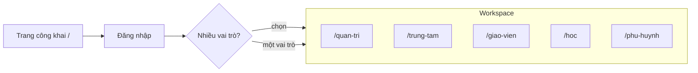

# 02 · Sitemap – TH – Tiếng Hàn

> Trạng thái: cập nhật theo phê duyệt ngày 2026-11-25 (D-B15, giảm số màn hình).
> Mã màn hình (C-, SA-, CA-, T-, HV-, PH-) và mức ưu tiên P0/P1/P2 được định nghĩa ở [06 §3](06-mvp-roadmap.md#3-danh-mục-màn-hình-mvp-và-mức-ưu-tiên). Route là **[Đề xuất]**.

---

## 1. Nguyên tắc

1. **Một ứng dụng, nhiều workspace.** Người có nhiều vai trò chuyển qua menu tài khoản → "Chuyển vai trò". Người chỉ có một vai trò không thấy bộ chuyển.
2. **Chỉ hiển thị chức năng đã triển khai và được cấp quyền.** Không có mục "Sắp ra mắt". Ví dụ: menu *Tài chính* của trung tâm không xuất hiện trong MVP.
3. **Gộp thay vì tách:** danh sách và chi tiết trên cùng màn hình (bảng + panel/trang chi tiết); tạo/sửa bằng một form, không wizard nhiều bước; tác vụ phụ (chuyển lớp, đổi lịch, liên kết phụ huynh…) là hộp thoại trong màn hình chính.
4. **Mobile:** học viên, phụ huynh dùng thanh điều hướng dưới, **tối đa 4–5 mục**. **Desktop:** giáo viên, trung tâm, quản trị dùng sidebar.
5. Mỗi màn hình một hành động chính. Icon Lucide, một bộ duy nhất; không dùng emoji thay icon.
6. Tài nguyên không có quyền trả về trang 404 (không lộ sự tồn tại).

`/tu-hoc` (Independent Learner, Phase 5) và `/sang-tao` (Content Creator, Phase 7) **không thuộc MVP** – xem §4.

---

## 2. Trang dùng chung

| Mã | Route | Màn hình | Ghi chú | Phase · Mức |
|---|---|---|---|---|
| C-05 | `/` , `/dieu-khoan`, `/bao-mat-du-lieu` | Trang công khai | Thương hiệu, chọn nhanh **Tiếng Hàn tổng hợp / KIIP** (giới thiệu ngắn, không mục lục), nút Đăng nhập; điều khoản & chính sách dữ liệu | 1 · P0 |
| C-06 | `/chuong-trinh/...` | Trang chương trình chi tiết | Khi có nội dung được phép công bố | 5 · P2 |
| C-01 | `/dang-nhap` | Đăng nhập | SĐT hoặc email + mật khẩu; link "Quên mật khẩu" | 1 · P0 |
| C-02 | `/mat-khau` | Đặt mật khẩu | Dùng chung cho: kích hoạt lần đầu, bắt buộc đổi mật khẩu tạm, đặt lại qua link | 1 · P0 |
| C-03 | `/tai-khoan` | Tài khoản | Hồ sơ, đổi mật khẩu, chuyển vai trò; HV: phụ huynh liên kết (đồng ý/thu hồi); PH: học viên liên kết | 1 · P0 |
| C-04 | icon chuông / `/thong-bao` (mobile) | Thông báo | Panel trên desktop, trang trên mobile | 2 · P1 |
| C-07 | `/import` | Import | Dùng chung: người dùng (Ph1), học liệu (Ph2). Tải mẫu → tải file → xem lỗi/trùng → xác nhận | 1 · P1 (người dùng), 2 · P0 (học liệu) |

---

## 3. Workspace MVP

### 3.1 Super Admin – `/quan-tri` (desktop)

| Menu | Mã | Màn hình | Nội dung (gộp) | Phase · Mức |
|---|---|---|---|---|
| Trung tâm | SA-01 | Trung tâm | Danh sách + chi tiết: thông tin, quản trị viên trung tâm, **giáo trình được cấp**, giới hạn số học viên/giáo viên, trạng thái | 1 · P0 |
| Giáo trình | SA-02 | Giáo trình | Cây **Hệ → Cấp độ → Phiên bản → Bài**; nguồn & quyền sử dụng khai báo ở Phiên bản | 1 · P0 |
| Người dùng | SA-03 | Người dùng | Tìm toàn nền tảng, khóa/mở, đặt lại mật khẩu, xem vai trò | 1 · P1 |
| Nhật ký | SA-04 | Nhật ký hệ thống | Audit log, lọc | 1 · P1 |
| Học liệu | SA-05 | Kho học liệu | Tab Từ vựng · Ngữ pháp · Media; bộ lọc **"Chờ duyệt"** = nơi kiểm duyệt (không có màn hình kiểm duyệt riêng) | 2 · P0 |
| (từ Giáo trình) | SA-06 | Biên tập bài học | Thành phần bài, liên kết từ/ngữ pháp/media, gửi duyệt, công bố | 2 · P0 |
| AI | SA-09 | AI | Bật/tắt, hạn mức, chi phí theo trung tâm/tính năng | 3 · P1 |
| Tổng quan | SA-08 | Tổng quan nền tảng | Trung tâm, người dùng hoạt động, chi phí AI | 4 · P2 |
| Cấu hình | SA-10 | Cấu hình | Thương hiệu, danh mục thành phần bài, loại lỗi (MVP dùng giá trị mặc định) | — · P2 |

Màn hình mặc định khi chưa có SA-08: **Trung tâm**.

### 3.2 Center Admin – `/trung-tam` (desktop, dùng được trên tablet)

| Menu | Mã | Màn hình | Nội dung (gộp) | Phase · Mức |
|---|---|---|---|---|
| Tổng quan | CA-01 | Hôm nay | Lớp học hôm nay (giờ, phòng, GV), buổi **chưa điểm danh**, học viên vắng; Ph2: lớp chưa giao bài / hoàn thành thấp; lớp lệch tiến độ | 1 · P0 |
| Lớp học | CA-02 | Lớp học | Danh sách + **form tạo/sửa lớp** (cơ sở, giáo trình–cấp độ–phiên bản, GV, khai giảng, số buổi, lịch cố định, phòng, học phí) | 1 · P0 |
| (từ Lớp học) | CA-03 | Chi tiết lớp | Tab **Học viên** (ghi danh, chuyển lớp, bảo lưu) · **Buổi học** (đổi lịch, nghỉ, học bù, điểm danh) · **Tiến độ** · **Bài tập** (Ph2) · **Kết quả** (Ph4) | 1 · P0 |
| Học viên | CA-04 | Học viên | Danh sách + chi tiết: thông tin, lớp, chuyên cần, **phụ huynh** (thêm/liên kết/thu hồi tại đây) | 1 · P0 |
| Giáo viên | CA-05 | Giáo viên | Danh sách + chi tiết: lớp phụ trách, lịch dạy | 1 · P0 |
| Lịch học | CA-06 | Lịch trung tâm | Lịch tuần theo cơ sở/phòng/GV; thấy trùng lịch | 1 · P1 |
| Báo cáo | CA-07 | Báo cáo | Chuyên cần (Ph1) · Hoàn thành bài (Ph2) · Chất lượng lớp (Ph4) | 1 · P1 |
| Cài đặt | CA-08 | Cài đặt | Thông tin trung tâm, **cơ sở & phòng**, múi giờ, quản trị viên; Ph3: bật AI | 1 · P0 |

Đã gộp: *Phụ huynh* → vào Học viên · *Chương trình* → hiển thị trong form lớp và Cài đặt · *Tài chính* → học phí là một trường của lớp (không có menu riêng trong MVP) · Học liệu riêng của trung tâm → dùng màn hình T-04 với quyền Center Admin (Ph2).

### 3.3 Teacher – `/giao-vien` (desktop; điểm danh tối ưu cho mobile)

| Menu | Mã | Màn hình | Nội dung (gộp) | Phase · Mức |
|---|---|---|---|---|
| Tổng quan | T-01 | Hôm nay | Lịch dạy hôm nay/tuần (gộp *Lịch dạy*) + việc cần làm: buổi chưa điểm danh; Ph2: bài chờ chấm, HV chưa nộp | 1 · P0 |
| (từ Hôm nay) | T-02 | Buổi học | Điểm danh → bài đã dạy → ghi chú/nhận xét; Ph2: nút **Giao bài sau buổi** | 1 · P0 |
| Lớp học | T-03 | Lớp của tôi | Dùng lại CA-03 ở chế độ giáo viên (không sửa ghi danh) | 1 · P1 |
| Học liệu | T-04 | Học liệu | Duyệt bài giáo trình; kho của tôi/trung tâm; soạn câu hỏi trong panel; Ph3: AI soạn | 2 · P0 |
| Bài tập | T-05 | Bài tập | Danh sách + **form giao bài** + tình trạng từng học viên | 2 · P0 |
| Chấm bài | T-06 | Chấm bài | Hàng chờ (trái) + bài làm/đáp án/điểm/nhận xét (phải); làm lại; công bố; Ph3: panel AI | 2 · P0 |
| Báo cáo | T-07 | Báo cáo lớp | Hoàn thành, điểm TB, câu/từ hay sai (Ph2); kỹ năng, tiến bộ (Ph4) | 2 · P1 |

### 3.4 Student – `/hoc` (mobile first)

Thanh dưới: **Hôm nay · Học tập · Bài tập · Sổ tay**. *Kết quả* và *Lịch* mở từ Hôm nay (giữ thanh dưới 4 mục, ít chữ).

| Menu | Mã | Màn hình | Nội dung (gộp) | Phase · Mức |
|---|---|---|---|---|
| Hôm nay | HV-01 | Hôm nay | Buổi học tiếp theo; Ph2: bài cần làm/sắp hết hạn, từ cần ôn, tiếp tục bài học | 1 · P0 |
| (từ Hôm nay) | HV-02 | Lịch học | Tuần/tháng, nghỉ, học bù, kiểm tra | 1 · P1 |
| Học tập | HV-03 | Học tập | Giáo trình đang học (nhiều nếu học nhiều lớp) → danh sách bài | 2 · P0 |
| (từ Học tập) | HV-04 | Bài học | Các thành phần bài; từ vựng, ngữ pháp mở dạng panel; luyện tập trong bài; lưu vào sổ tay | 2 · P0 |
| Bài tập | HV-05 | Bài tập | Cần làm · Đã nộp · Đã có điểm | 2 · P0 |
| (từ Bài tập) | HV-06 | Làm bài | Làm, tự lưu, nộp; sau công bố cùng màn hình hiển thị kết quả và làm lại câu sai (nếu được phép) | 2 · P0 |
| (từ Hôm nay) | HV-07 | Ôn từ vựng | Flashcard theo lịch ôn | 2 · P1 |
| Sổ tay | HV-08 | Sổ tay | Từ · Ngữ pháp · Câu sai (theo loại lỗi) · Ghi chú; luyện lại lỗi | 2 · P1 |
| (từ Hôm nay) | HV-09 | Kết quả | Tiến độ giáo trình, điểm các bài, mức ghi nhớ; "Chưa đủ dữ liệu" khi dưới ngưỡng | 2 · P1 |

### 3.5 Parent – `/phu-huynh` (mobile first)

Thanh dưới: **Hôm nay · Lịch học · Bài tập · Kết quả**. Thông báo là icon chuông. Nhiều con → chọn con ở đầu trang.

| Menu | Mã | Màn hình | Trả lời câu hỏi | Phase · Mức |
|---|---|---|---|---|
| Hôm nay | PH-01 | Hôm nay của con | Hôm nay con có học không, có mặt không? Buổi sau khi nào? Đang học giáo trình/bài nào? Ph2: bài giao / đã nộp / chưa làm / quá hạn, điểm mới | 1 · P0 |
| Lịch học | PH-02 | Lịch & điểm danh | Lịch tuần/tháng, nghỉ, học bù; lịch sử có mặt/vắng/muộn/có phép | 1 · P0 |
| Bài tập | PH-03 | Bài tập của con | Tên, GV, ngày giao, hạn, tình trạng, thời điểm nộp, điểm & nhận xét **đã công bố** | **2** · P0 |
| Kết quả | PH-04 | Kết quả & báo cáo | Chuyên cần, hoàn thành bài, tiến độ giáo trình, nhận xét GV, báo cáo tuần/tháng | 4 · P1 |

> Trong Phase 1 thanh dưới của phụ huynh chỉ có **Hôm nay · Lịch học**; *Bài tập* xuất hiện khi Phase 2 chạy; *Kết quả* ở Phase 4.

---

## 4. Ngoài MVP (tham khảo)

| Workspace | Phase | Ghi chú |
|---|---|---|
| `/tu-hoc` – Independent Learner | 5 | Đánh giá đầu vào, lộ trình, luyện tập, AI Tutor, sổ tay (dùng chung dữ liệu với `/hoc`), tiến độ. Có gộp với `/hoc` hay không: quyết định ở Phase 5 |
| Trang khóa học, đăng ký B2C | 5–6 | |
| `/sang-tao` – Content Creator, Marketplace | 7 | |
| Tài chính, thanh toán, gói | 6 | |
