# 03 · User Flow – TH – Tiếng Hàn

> Trạng thái: cập nhật theo phê duyệt 2026-11-25 · Quy tắc bài tập chi tiết ở [08-homework-assessment.md](08-homework-assessment.md). Nhãn (Ph2), (Ph3)… = phase triển khai; không ghi = Phase 1.

---

## 1. Luồng xuyên suốt (kịch bản nghiệm thu chính)

Theo Master Prompt: *Trung tâm tạo lớp → chọn giáo trình → thêm GV/HV → lịch → điểm danh → nội dung buổi → giao bài → làm → nộp → chấm → GV duyệt → công bố → PH xem kết quả.*

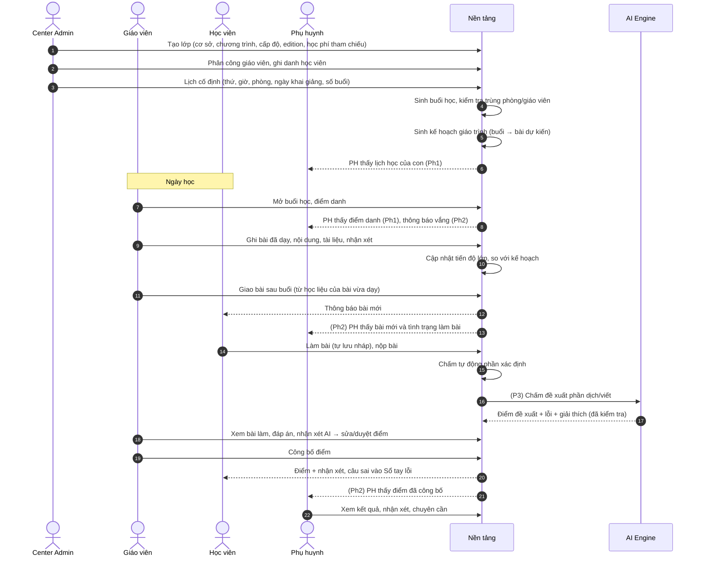

---

## 2. Thiết lập trung tâm và lớp học

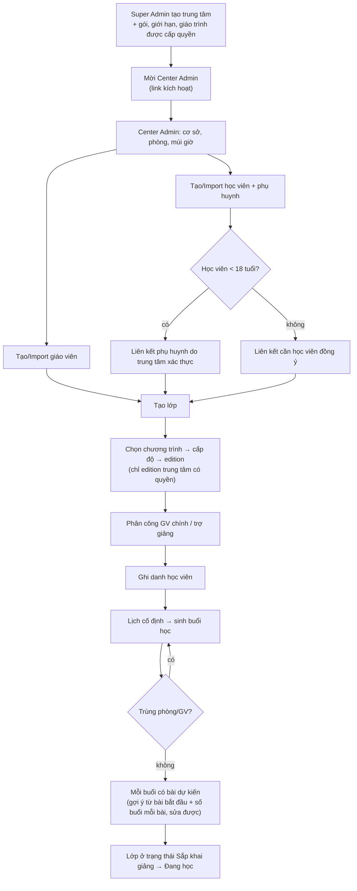

**Thông tin lớp:** tên, chương trình, giáo trình/cấp độ/edition, giáo viên, học viên, ngày khai giảng, số buổi, lịch cố định, phòng, ngày dự kiến kết thúc (tính từ lịch), học phí tham chiếu.

---

## 3. Buổi học, điểm danh và tiến độ

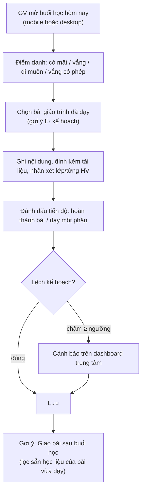

- Điểm danh sửa được trong **cửa sổ chỉnh sửa** (vd. 48h, cấu hình được); sau đó chỉ Center Admin sửa, có lý do và lịch sử.
- Đổi giờ/phòng: sửa trực tiếp buổi học, lưu lịch sử thay đổi. Nghỉ: buổi → `CANCELLED` (lý do); học bù là buổi mới liên kết buổi đã nghỉ. Học viên/phụ huynh nhận thông báo.
- Tiến độ lớp = bài cao nhất đã hoàn thành theo **thứ tự bài trong edition**; "đúng tiến độ" = so với bài dự kiến của buổi gần nhất trong kế hoạch.

---

## 4. Giao bài → làm → nộp → chấm → công bố

Trạng thái và quy tắc chi tiết: [08-homework-assessment.md](08-homework-assessment.md). Tóm tắt luồng:

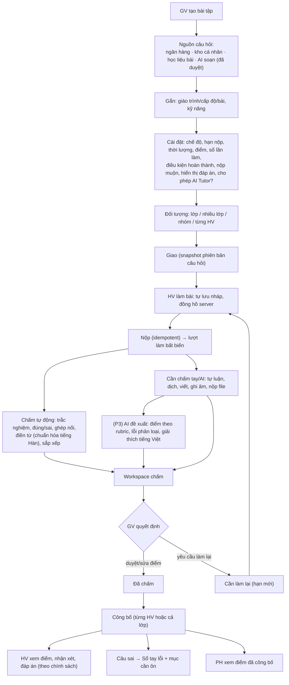

**Chuẩn hóa so khớp đáp án tiếng Hàn (rule engine):** Unicode NFC, bỏ khoảng trắng thừa đầu/cuối, tùy chọn *bỏ qua khoảng cách từ* (띄어쓰기) và *bỏ dấu câu* theo từng câu hỏi; danh sách đáp án chấp nhận. Khoảng cách từ là một loại lỗi được ghi nhận riêng — giáo viên chọn có trừ điểm hay không.

**Trạng thái hiển thị (tách hai chiều):**

| Chiều | Giá trị |
|---|---|
| Tình trạng làm bài | Chưa bắt đầu · Đang làm · Đã nộp · Chờ chấm · Đã chấm · Cần làm lại |
| Thời hạn | Đúng hạn · Nộp muộn · Quá hạn chưa nộp |
| Hiển thị cho PH/HV | Điểm chỉ hiện khi **Đã công bố**; "Đã chấm" chưa công bố hiển thị là "Đã nộp" |

---

## 5. Luồng xây dựng và import học liệu

### 5.1 Import Excel/CSV

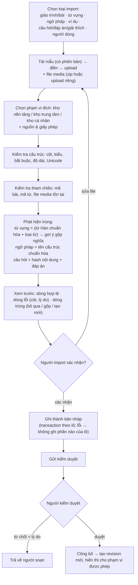

- Import **không bao giờ** tự công bố. Lô import có thể *hoàn tác* trước khi công bố.
- Ai kiểm duyệt: kho nền tảng → biên tập viên được Super Admin chỉ định; kho trung tâm → Center Admin hoặc giáo viên được cấp quyền "kiểm duyệt học liệu" (D-B07).
- Upload media: kiểm tra định dạng thật (magic bytes), dung lượng, thời lượng audio; lưu riêng tư, phát qua URL ký tạm thời.

### 5.2 Trạng thái học liệu

```mermaid
stateDiagram-v2
    [*] --> DRAFT: soạn / import / AI tạo
    DRAFT --> IN_REVIEW: gửi kiểm duyệt
    IN_REVIEW --> DRAFT: từ chối (lý do)
    IN_REVIEW --> PUBLISHED: duyệt
    PUBLISHED --> DRAFT: tạo bản sửa (revision mới, bản cũ vẫn phục vụ)
    PUBLISHED --> RETIRED: ngừng dùng (không xóa; bài đã giao vẫn xem được)
    RETIRED --> [*]
```

### 5.3 AI hỗ trợ soạn học liệu (Phase 3)

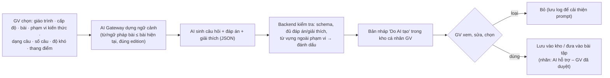

---

## 6. Học viên: học, ôn và vòng thích ứng

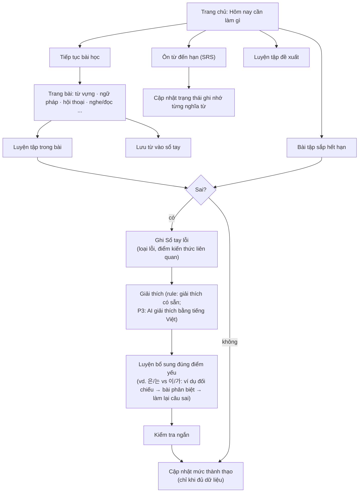

- Chế độ thi/bài giới hạn hỗ trợ: các nút *Giải thích / Hỏi AI* **không hiển thị và bị chặn ở backend** cho tới khi nộp bài.

---

## 7. Phụ huynh

### 7.1 Liên kết phụ huynh – học viên

```mermaid
stateDiagram-v2
    [*] --> PENDING: trung tâm tạo liên kết / PH yêu cầu bằng mã
    PENDING --> ACTIVE: xác thực (trung tâm xác nhận; HV ≥ 18 tuổi đồng ý)
    PENDING --> REJECTED: HV từ chối / trung tâm hủy
    ACTIVE --> REVOKED: thu hồi (trung tâm / HV trưởng thành / PH tự rời)
    REVOKED --> [*]
    REJECTED --> [*]
```

- Liên kết **nhiều–nhiều**: một PH nhiều con, một HV nhiều người giám hộ.
- Thu hồi có hiệu lực **ngay lập tức** (request tiếp theo của PH bị từ chối), có audit log.
- Phạm vi xem mặc định: dữ liệu học viên **tại các trung tâm** (lịch, điểm danh, bài tập, điểm đã công bố, nhận xét, báo cáo). Dữ liệu tự học B2C của học viên chỉ hiển thị nếu học viên/người giám hộ hợp pháp cho phép (D-B08).

### 7.2 Hành trình phụ huynh (mobile)

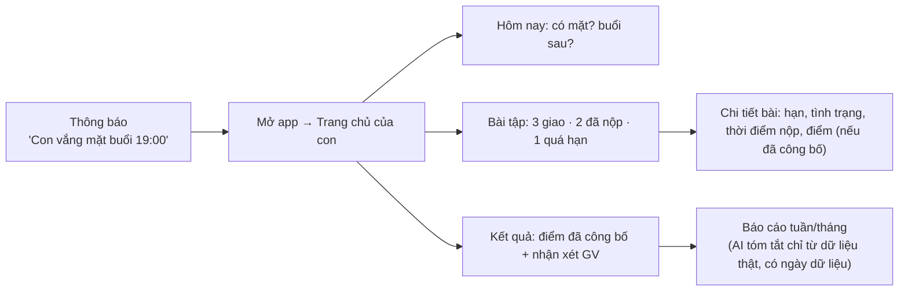

Báo cáo tuần/tháng: số liệu được tính bằng truy vấn; AI (nếu bật) chỉ diễn đạt lại số liệu và nhận xét đã có của giáo viên, kèm ghi chú "tóm tắt tự động". Không có dữ liệu → hiển thị "Chưa có dữ liệu", không tạo nhận xét.

---

## 8. Các luồng thay đổi giữa khóa

| Tình huống | Luồng | Dữ liệu được giữ |
|---|---|---|
| **Chuyển lớp** | Center Admin chọn lớp đích + ngày hiệu lực → ghi danh cũ `TRANSFERRED`, ghi danh mới `ACTIVE` (liên kết nhau) | Điểm danh, bài nộp, điểm ở lớp cũ; bài tập đang mở ở lớp cũ: mặc định vẫn nộp được đến hạn (D-B11) |
| **Bảo lưu** | Ghi danh `ON_HOLD` với ngày bắt đầu/dự kiến quay lại; không nhận bài mới, không tính vắng | Toàn bộ |
| **Đổi giáo viên** | Phân công mới có ngày hiệu lực; GV cũ mất quyền với lớp từ ngày đó | Bài tập do GV cũ tạo vẫn thuộc lớp; quyền chấm chuyển cho GV mới |
| **Đổi lịch / nghỉ / học bù** | Sửa buổi đơn lẻ hoặc từ ngày X trở đi; kiểm tra trùng; thông báo HV/PH | Lịch sử thay đổi buổi học |
| **Đổi phiên bản giáo trình** của lớp (**P2**) | Chọn edition mới → hệ thống đề xuất ánh xạ bài theo *lesson mapping* (nếu có) → Center Admin xác nhận bài tương ứng hiện tại | Tiến độ cũ theo edition cũ; tiến độ mới bắt đầu từ bài đã ánh xạ; bài tập đã giao giữ nguyên snapshot |
| **Sửa câu hỏi đã giao** | Sửa câu gốc tạo *phiên bản mới*; đề đã giao vẫn dùng phiên bản cũ. Sửa đáp án trong đề đang mở → luồng E17 (chấm lại + lịch sử + thông báo) | Mọi phiên bản |
| **Người tự học gia nhập trung tâm** (Phase 5) | Trung tâm mời bằng SĐT/email đã có → tạo *vai trò Student @ trung tâm* trên **tài khoản sẵn có** (không tạo tài khoản mới) | Sổ tay, SRS, khóa đã mua; trung tâm **không** tự động thấy dữ liệu tự học (D-B08) |

---

## 9. State machine chính

### 9.1 Ghi danh (Enrollment)

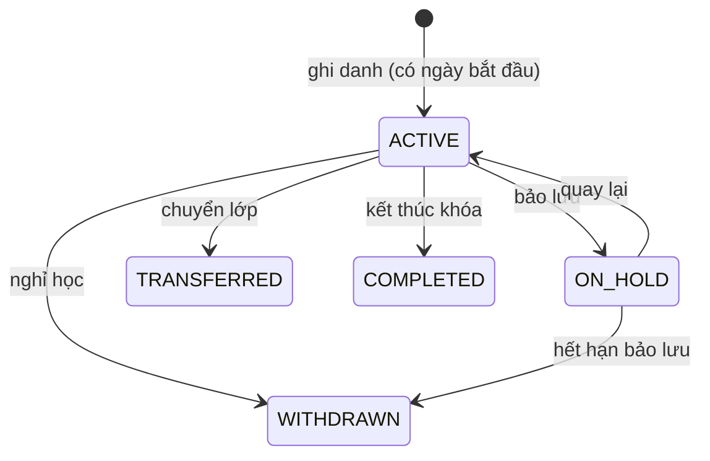

### 9.2 Buổi học (Class Session)

```mermaid
stateDiagram-v2
    [*] --> SCHEDULED: sinh từ lịch cố định / tạo tay / học bù
    SCHEDULED --> SCHEDULED: đổi giờ/phòng/GV (ghi lịch sử)
    SCHEDULED --> CANCELLED: nghỉ (lý do; tùy chọn tạo buổi học bù)
    SCHEDULED --> COMPLETED: GV điểm danh + ghi bài đã dạy
    COMPLETED --> COMPLETED: sửa trong 48h (GV) hoặc sau đó (CA, có lý do)
```

### 9.3 Bài tập, lượt làm, điểm, AI job

Xem [08 §4](08-homework-assessment.md#4-trạng-thái). AI job (Phase 3): `QUEUED → RUNNING → SUCCEEDED | INVALID → FAILED | SKIPPED_QUOTA | CANCELLED`.

Bổ sung: lượt làm ở chế độ **Luyện tập/Học** không qua `GRADING/PUBLISHED` — kết quả tức thời, nhãn *"Phản hồi luyện tập – không phải điểm chính thức"*.

### 9.4 Import job

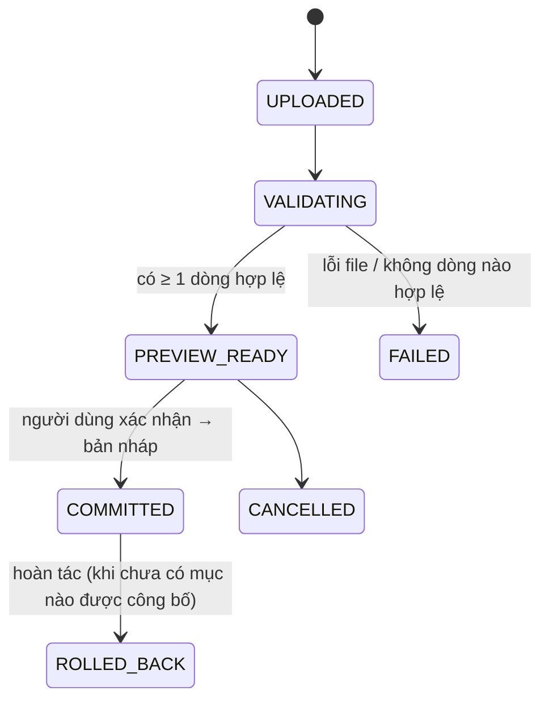

---

## 10. Ngoại lệ và kiểm thử bổ sung

Ngoại lệ của bài tập (E01–E14): [08 §8](08-homework-assessment.md#8-ngoại-lệ-giữ-từ-bản-cũ-đã-điều-chỉnh). Bổ sung theo Master Prompt:

| # | Tình huống | Xử lý mong đợi |
|---|---|---|
| X01 | Học viên học **đồng thời hai giáo trình** (vd. lớp TH02 + lớp KIIP01) | Tiến độ, bài tập, kế hoạch tách theo lớp/edition; SRS dùng chung theo nghĩa từ (học ở đâu cũng được tính); AI context theo bài tập/bài học đang mở |
| X02 | Đổi edition giáo trình giữa khóa | Luồng §8; bài tập cũ giữ snapshot; báo cáo tiến độ ghi rõ edition |
| X03 | Import file lỗi encoding / thiếu cột / sai mã bài | Báo lỗi từng dòng/cột; không ghi gì; mẫu chuẩn UTF-8 |
| X04 | Import trùng (cùng từ đã có ở kho chung) | Gợi ý gộp nghĩa hoặc liên kết; không tạo bản trùng nếu chưa xác nhận |
| X05 | Mất mạng khi làm bài / nộp nhiều lần | Nháp lưu cục bộ + đồng bộ khi có mạng; nộp idempotent (E01, E03) |
| X06 | Ghi âm thất bại / file quá lớn trên di động | Báo lỗi trước khi nộp; cho phép ghi lại; giới hạn thời lượng; không mất phần đã trả lời |
| X07 | Thay đổi bài đã giao | Chỉ sửa thông tin không ảnh hưởng chấm khi đã có bài nộp; sửa đáp án → chấm lại + lịch sử + thông báo (E17) |
| X08 | Đổi lịch khi đã có bài tập hạn theo buổi | Hạn nộp không tự dời; cảnh báo GV các bài có hạn trùng buổi bị đổi |
| X09 | AI trả lời vượt cấp độ (dùng ngữ pháp chưa học) | Bộ kiểm tra phạm vi đánh dấu từ/cấu trúc ngoài danh sách đã học; cảnh báo GV; nếu nội dung cho HV → yêu cầu sinh lại một lần rồi mới hiển thị kèm cảnh báo |
| X10 | AI trả JSON sai / điểm vượt max | Validate → INVALID → retry 1 lần → FAILED → chấm tay (E07) |
| X11 | Thu hồi liên kết phụ huynh khi PH đang mở app | Request tiếp theo trả 404; thông báo cache bị xóa; audit log |
| X12 | Truy cập trái phép dữ liệu trung tâm khác (đổi ID trên URL/API) | 404; không lộ sự tồn tại; ghi log bảo mật; test tự động cho mọi endpoint |
| X13 | Học viên bị rút khỏi lớp khi bài đang mở | Theo Q4 cũ: nộp được bài đang làm đến hạn, không nhận bài mới |
| X14 | Giáo viên dạy ở hai trung tâm | Hai vai trò Teacher độc lập; dữ liệu không trộn; chuyển ngữ cảnh mới thấy trung tâm kia |
| X15 | Học viên trưởng thành từ chối liên kết phụ huynh | Liên kết `REJECTED`; PH không xem được; trung tâm thấy trạng thái |
| X16 | Nội dung KIIP5 về pháp luật/thủ tục hết hạn cập nhật | Hiển thị ngày cập nhật; quá ngưỡng (vd. 12 tháng) → hàng chờ rà soát cho biên tập |
| X17 | Trung tâm hết hạn gói / vượt số học viên | Không chặn học viên đang học giữa chừng; chặn tạo mới; cảnh báo Center Admin & Super Admin (chính sách cụ thể: D-B10) |
