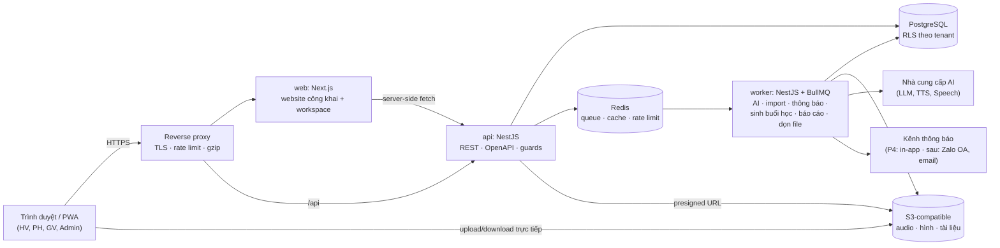
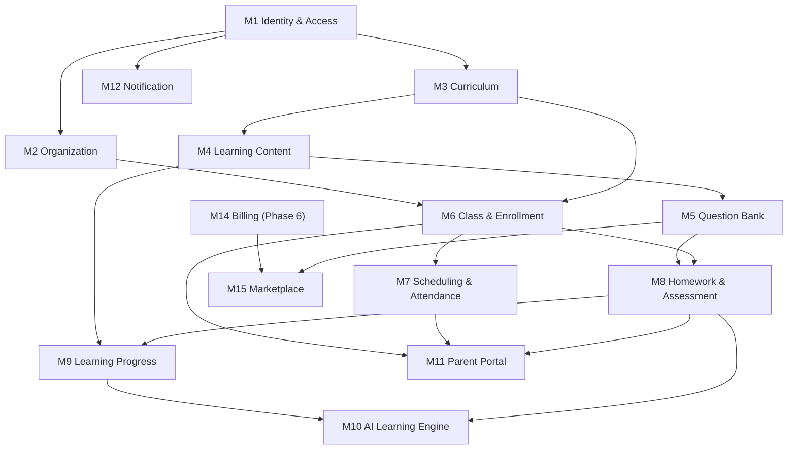
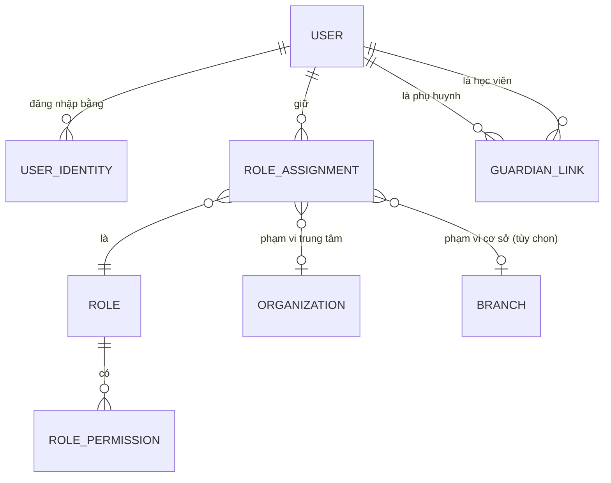
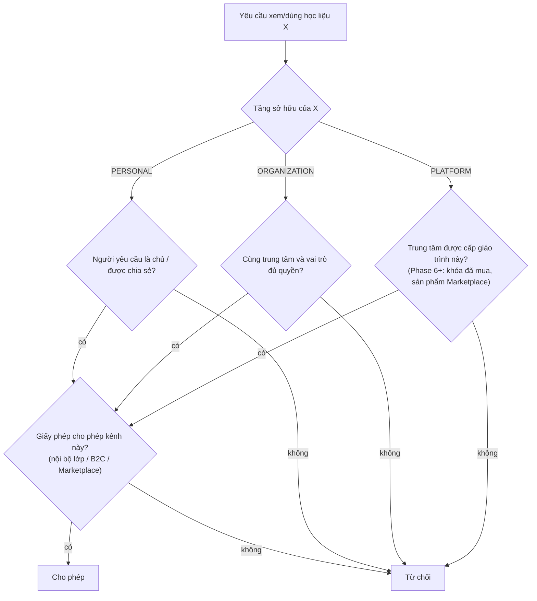
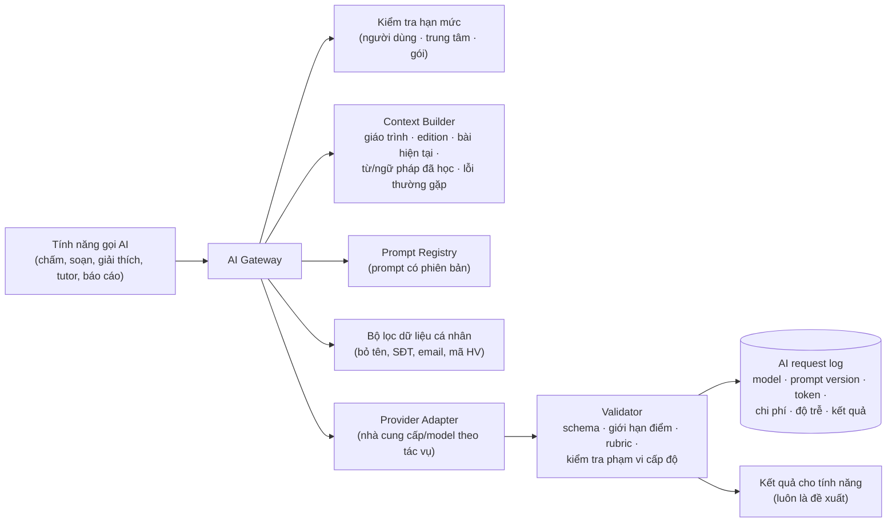

# 04 · System Architecture – TH – Tiếng Hàn

> Trạng thái: **Multi-tenant + Modular Monolith đã được phê duyệt** (2026-11-25). Các lựa chọn kỹ thuật chi tiết đã chốt ở [07 §3](07-decisions-pending.md#3-quyết-định-kỹ-thuật-đã-chốt-nhóm-kỹ-thuật-chủ-sản-phẩm-có-quyền-phủ-quyết); còn chờ: hạ tầng (D-T04), nhà cung cấp AI (D-T06), TTS (D-T07).

---

## 1. Bối cảnh lựa chọn

- Repository không có mã nguồn → không có kiến trúc cũ phải giữ.
- Master Prompt §7.4 gợi ý Next.js/React/TypeScript, NestJS, PostgreSQL, S3-compatible, Redis/BullMQ, Docker/HTTPS; ưu tiên **modular monolith**.
- Tài liệu Homework trước đó đã đề xuất cùng stack → giữ để tái sử dụng phân tích.

**Đề xuất: modular monolith TypeScript** — một codebase backend chia module có ranh giới rõ, triển khai thành **2 process** (API và Worker) dùng chung code; frontend Next.js riêng. Không microservices ở giai đoạn này.

---

## 2. Stack đề xuất

| Lớp | Lựa chọn | Lý do | Phương án thay thế |
|---|---|---|---|
| Monorepo | pnpm workspaces + Turborepo | Dùng chung type/schema FE–BE, một lệnh build/test | Nx |
| Frontend | Next.js (App Router) + React + TypeScript + Tailwind + shadcn/ui + **Lucide Icons** + TanStack Query + React Hook Form + Zod | Theo Master Prompt; SSR cho website công khai (SEO), SPA-like cho workspace | — |
| Font | Noto Sans + Noto Sans KR (tự host, subset) | Hỗ trợ Việt + Hàn, không phụ thuộc CDN | Pretendard cho Hàn |
| Soạn thảo nội dung | TipTap (ProseMirror), lưu JSON | Render theo whitelist node → chống XSS; hỗ trợ ruby/chú thích từ sau này | — |
| PWA | Manifest + service worker (cache shell, nháp offline) | Mobile first cho HV/PH; cài lên màn hình chính | App native (sau) |
| Backend | NestJS + REST + OpenAPI | Module/DI/guard rõ ràng cho RBAC + tenant | Fastify thuần |
| ORM / migration | Prisma (D-T02) | Migration có version, type-safe; dùng `$queryRaw` cho truy vấn báo cáo | Drizzle, Kysely |
| Database | PostgreSQL 16+ | Quan hệ phức tạp, transaction, RLS, JSONB, full-text, `pg_trgm` cho tìm từ | — |
| Queue / cache | Redis + BullMQ | AI job, thông báo, import, sinh buổi học, báo cáo định kỳ | — |
| Lưu trữ file | S3-compatible (MinIO khi dev) | Audio/hình/video/PDF; presigned URL; bucket private | — |
| Tìm kiếm | PostgreSQL FTS + `pg_trgm` (MVP) | Đủ cho kho từ vựng/câu hỏi cỡ vừa | OpenSearch (khi cần) |
| AI | AI Gateway nội bộ, adapter theo nhà cung cấp (D-T06) | Đổi nhà cung cấp/model không sửa nghiệp vụ | — |
| TTS / Speech | Adapter (D-T07) | Audio từ vựng/câu; Phase 5 nhận diện & đánh giá phát âm | — |
| Auth | Session/JWT ngắn hạn + refresh xoay vòng trong httpOnly cookie, CSRF token | Không lộ token cho JS | — |
| Test | Vitest (unit), Supertest + Testcontainers (integration), Playwright (E2E, có profile mobile) | Kiểm tra trạng thái DB và quyền, không chỉ HTTP 200 | — |
| Hạ tầng | Docker, Docker Compose, Nginx/Caddy (HTTPS) trên VPS; managed Postgres/S3 khi tăng tải (D-T09) | Đơn giản, chi phí thấp cho pilot Horizon | Kubernetes (không cần sớm) |
| Quan sát | Log JSON (pino) + request id, OpenTelemetry, Sentry (hoặc tương đương), health check | Truy vết lỗi theo tenant/người dùng | — |

---

## 3. Sơ đồ triển khai



- API key AI/TTS **chỉ** tồn tại ở worker/API (biến môi trường/secret manager).
- Gọi AI đồng bộ (AI Tutor trả lời trực tiếp, Phase 5) đi qua API với streaming; chấm bài và soạn học liệu đi qua worker.

---

## 4. Module (modular monolith)

### 4.1 Danh sách module và trách nhiệm

| # | Module | Trách nhiệm | Phụ thuộc chính | Phase |
|---|---|---|---|---|
| M1 | **Identity & Access** | Người dùng, phương thức đăng nhập, phiên, vai trò theo phạm vi, chính sách quyền, audit | — | 1 |
| M2 | **Organization** | Trung tâm (tenant), cơ sở, phòng, cấu hình, giới hạn người dùng, giáo trình được cấp | M1 | 1 |
| M3 | **Curriculum** | Hệ, cấp độ, phiên bản, bài, thành phần bài, nguồn & quyền sử dụng; (P2) tương ứng bài giữa phiên bản | M1 | 1 |
| M4 | **Learning Content** | Từ vựng (mục từ/nghĩa), ngữ pháp, ví dụ, media, chủ đề xã hội, revision, kiểm duyệt, import | M3 | 2 |
| M5 | **Question Bank** | Câu hỏi + phiên bản bất biến, dạng câu hỏi, tag kiến thức, đề/bộ luyện tập, exam blueprint | M3, M4 | 2 |
| M6 | **Class & Enrollment** | Lớp, phân công GV, ghi danh, chuyển lớp, bảo lưu, tiến độ lớp | M2, M3 | 1 |
| M7 | **Scheduling & Attendance** | Lịch cố định, buổi học (có bài dự kiến), đổi lịch/nghỉ/bù, kiểm tra trùng, điểm danh, nội dung buổi | M6 | 1 |
| M8 | **Homework & Assessment** | Bài tập, giao bài, lượt làm, câu trả lời, chấm tự động, chấm tay, rubric, duyệt, công bố, lịch sử điểm; loại Bài tập/Kiểm tra (thi thử: Phase 5) | M5, M6 | 2 |
| M9 | **Learning Progress** *(độc lập, không phụ thuộc AI – đã duyệt)* | Tiến độ bài học, SRS, sổ tay, sổ tay lỗi, mức thành thạo | M4, M8 | 2 |
| M10 | **AI Learning Engine** | AI Gateway, dựng ngữ cảnh giáo trình, prompt registry, chấm đề xuất, soạn học liệu, giải thích, ôn thích ứng, hạn mức & chi phí | M3, M4, M5, M8, M9 | 3 |
| M11 | **Parent Portal** | Liên kết PH–HV, đồng ý, dữ liệu xem cho phụ huynh | M1, M6, M7, M8 | 1 (liên kết, lịch, điểm danh) · 2 (bài tập) · 4 (báo cáo) |
| M12 | **Notification** | Sự kiện → thông báo, tùy chọn nhận, kênh (in-app; sau MVP: Zalo OA, email, push) | M1 | 2 |
| M13 | **Reporting & Analytics** | Dashboard, báo cáo lớp/HV/trung tâm, báo cáo tuần/tháng, xuất Excel | Đọc từ các module | 1 → 4 |
| M14 | **Billing** | Sản phẩm, gói, giá, đơn hàng, thanh toán, thuê bao | M1, M2 | 6 (ngoài MVP) |
| M15 | **Marketplace** | Người bán, sản phẩm học liệu, kiểm duyệt, chia sẻ doanh thu, đối soát | M4, M5, M14 | 7 (ngoài MVP) |

> M9 *Learning Progress* là module bổ sung so với danh sách Master Prompt (đã duyệt): ôn từ vựng, sổ tay, sổ tay lỗi chạy **không cần AI** từ Phase 2; AI (M10) chỉ đọc dữ liệu từ M9 và đề xuất thêm, M9 không gọi AI.

### 4.2 Quy tắc ranh giới

1. Mỗi module sở hữu bảng của mình; module khác **không** truy vấn trực tiếp bảng đó mà gọi service công khai (interface) của module.
2. Giao tiếp không đồng bộ qua **domain event** ghi vào bảng *outbox* trong cùng transaction → worker phát lại (đảm bảo không mất sự kiện như "đã công bố điểm").
3. Reporting được phép đọc trực tiếp qua **view/materialized view** chỉ-đọc.
4. Kiểm tra phụ thuộc vòng bằng lint rule (vd. `eslint-plugin-boundaries`/dependency-cruiser) trong CI.



### 4.3 Cấu trúc thư mục đề xuất

```
apps/
  web/                 # Next.js: (public)/, (auth)/, quan-tri/, trung-tam/, giao-vien/, hoc/, phu-huynh/, tu-hoc/, sang-tao/
  api/                 # NestJS bootstrap HTTP
  worker/              # NestJS bootstrap BullMQ processors
packages/
  modules/             # backend modules: identity, organization, curriculum, content, question-bank,
                       # classes, scheduling, homework, progress, ai, parent, notification, reporting, billing
  db/                  # Prisma schema, migrations, seed (dev/test only)
  contracts/           # Zod schema + OpenAPI types dùng chung FE/BE
  ui/                  # design system: tokens, components (shadcn), icons
  korean/              # tiện ích tiếng Hàn: chuẩn hóa NFC, tách âm tiết/jamo, kiểm tra patchim,
                       # chuẩn hóa so khớp đáp án, romanization (thuần code, có unit test)
  config/              # eslint, tsconfig, boundaries
docs/
```

---

## 5. Identity, xác thực và phân quyền

### 5.1 Mô hình định danh



- **USER** = một người thật. **USER_IDENTITY** = phương thức đăng nhập (`PHONE`, `EMAIL`, `USERNAME`, `GOOGLE`, …) với cờ *đã xác thực*. Ràng buộc duy nhất trên `(type, normalized_value)` → không tạo trùng tài khoản; khi người dùng thêm phương thức mới đã xác thực, nó được gắn vào USER hiện tại.
- **ROLE_ASSIGNMENT** = (user, role, scope_type, scope_id, hiệu lực từ–đến). Vai trò Teacher/Student/Center Admin luôn có `organization_id`.
- **Independent Learner** không phải một role assignment bắt buộc: mọi USER có *không gian cá nhân*; quyền tự học đến từ **entitlement** (gói miễn phí/khóa đã mua).
- **Parent** = có ít nhất một GUARDIAN_LINK `ACTIVE`; quyền xem suy ra từ liên kết, không cần role gán tay.

### 5.2 Xác thực (MVP)

| Hạng mục | MVP | Sau MVP |
|---|---|---|
| Phương thức | SĐT hoặc email + mật khẩu (tài khoản do trung tâm tạo, kích hoạt qua link/mã) | OTP SMS/Zalo, Google, tự đăng ký (P5) |
| Mật khẩu | Argon2id, chính sách độ dài, chặn mật khẩu phổ biến | — |
| Phiên | Access token ngắn hạn + refresh xoay vòng (httpOnly, Secure, SameSite=Lax), thu hồi khi đổi mật khẩu/khóa | Quản lý thiết bị |
| Chống dò | Rate limit theo IP + định danh, khóa tạm thời | CAPTCHA khi bất thường |

### 5.3 Ủy quyền: RBAC + phạm vi + quan hệ

Mọi request đi qua 3 lớp kiểm tra **ở backend**:

1. **Ngữ cảnh**: request mang `active_context` (role assignment đang chọn). Backend xác minh assignment còn hiệu lực.
2. **Quyền chức năng** (RBAC): role có permission `homework.grade`, `attendance.write`, …?
3. **Quyền trên tài nguyên** (scope/relationship): tài nguyên thuộc tenant của ngữ cảnh *và* thỏa quan hệ — GV được phân công lớp đó; HV là chủ lượt làm; PH có liên kết ACTIVE với HV chủ dữ liệu; nội dung có entitlement.

Chính sách tập trung trong *policy service* (một hàm `can(actor, action, resource)` cho mỗi loại tài nguyên), test bảng (table-driven) cho từng vai trò × hành động × trường hợp biên. Tài nguyên không có quyền → **404**.

### 5.4 Ma trận quyền tóm tắt (MVP)

| Tài nguyên | Super Admin | Center Admin | Teacher | Student | Parent |
|---|---|---|---|---|---|
| Trung tâm, gói | CRUD | Xem/sửa thông tin của mình | — | — | — |
| Cơ sở, phòng | Xem | CRUD | Xem | — | — |
| Giáo trình/edition/bài (khung) | CRUD | Xem (được cấp quyền) | Xem | Xem (đang học) | Xem tên bài |
| Học liệu nền tảng | CRUD + duyệt | Xem | Xem/dùng | Xem (theo bài được học) | — |
| Học liệu trung tâm | — (hỗ trợ có audit) | CRUD + duyệt | CRUD (kho cá nhân), đề xuất lên kho trung tâm | Xem khi được giao | — |
| Lớp, ghi danh | Xem | CRUD | Xem lớp phụ trách | Xem lớp mình | Xem lớp của con |
| Buổi học, lịch | Xem | CRUD | Sửa buổi mình dạy | Xem | Xem |
| Điểm danh | Xem | Sửa (có lý do) | Ghi/sửa trong cửa sổ | Xem của mình | Xem của con |
| Bài tập | Xem | Xem | CRUD lớp phụ trách | Làm/nộp | Xem tình trạng |
| Điểm | Xem | Xem (sửa: D-B09) | Chấm/duyệt/công bố | Xem đã công bố | Xem đã công bố |
| Nhận xét AI | Xem log | — | Xem/dùng | Theo cấu hình bài | — |
| Liên kết phụ huynh | Xem | CRUD | Xem | Đồng ý/thu hồi (≥ 18) | Yêu cầu/rời |
| Audit log | Toàn bộ | Của trung tâm | — | — | — |

---

## 6. Multi-tenancy

| Hạng mục | Đề xuất |
|---|---|
| Mô hình | **Một database, schema dùng chung, cột `organization_id`** trên mọi bảng thuộc trung tâm |
| Lớp bảo vệ 1 | Tầng repository tự thêm điều kiện tenant từ ngữ cảnh request (không cho truy vấn thiếu tenant) |
| Lớp bảo vệ 2 | **PostgreSQL Row-Level Security**: mỗi transaction `SET LOCAL app.org_id = …`; policy RLS chặn hàng khác tenant ngay cả khi code quên điều kiện (D-T03) |
| Dữ liệu không thuộc tenant | Người dùng, định danh, kho học liệu nền tảng, giáo trình, dữ liệu học cá nhân (SRS, sổ tay) — kiểm soát bằng quan hệ/entitlement |
| Học liệu 3 tầng | `PLATFORM` (của nền tảng) · `ORGANIZATION` (của trung tâm) · `PERSONAL` (của giáo viên/người sáng tạo). Chia sẻ lên tầng trên phải qua kiểm duyệt |
| Kiểm thử | Bộ test "tenant leak": với mỗi endpoint, actor tenant A truy cập ID của tenant B → phải 404 |
| Mở rộng | Khi có khách hàng B2B lớn yêu cầu tách: chuyển tenant sang database riêng (cùng schema) — thiết kế không chặn hướng này |

---

## 7. Truy cập học liệu và quyền sử dụng



- MVP: quyền dùng học liệu nền tảng của trung tâm = **giáo trình được cấp cho trung tâm** (Super Admin cấp tay). Khái niệm quyền sử dụng tổng quát (khóa học, gói, sản phẩm đã mua) chỉ thêm ở Phase 6.
- **Đáp án và giải thích** là tài nguyên riêng: không bao giờ nằm trong payload gửi HV trước thời điểm chính sách cho phép (kiểm tra ở serializer phía backend).

---

## 8. AI Learning Engine

### 8.1 Thành phần



### 8.2 Curriculum-aware context

- Đầu vào: `curriculum_edition_id`, `lesson_id` hiện tại, chế độ (học/luyện/bài tập/thi).
- Context Builder truy vấn **có cấu trúc** (không cần vector DB ở MVP): danh sách nghĩa từ và điểm ngữ pháp liên kết các bài có `order ≤ bài hiện tại` trong edition; ưu tiên bài hiện tại và bài trước; lỗi thường gặp của học viên (từ M9, đã ẩn danh).
- **Kiểm tra phạm vi** sau khi sinh: tách từ trong đầu ra (dựa trên danh sách từ đã học + chuẩn hóa đuôi chia), đánh dấu từ/cấu trúc ngoài phạm vi. Kết quả gắn cờ thay vì âm thầm hiển thị.
- Thiếu dữ liệu bài → AI được hướng dẫn nói rõ "chưa có dữ liệu bài này"; không bịa nội dung giáo trình.
- Mở rộng sau: embedding (pgvector) cho tìm ví dụ/bài đọc liên quan.

### 8.3 Chấm đề xuất (AI Grading)

| Bước | Nội dung |
|---|---|
| 1 | Câu trả lời xác định → rule engine (không gọi AI) |
| 2 | Dịch/viết/tự luận → job AI với: đề, đáp án tham khảo, rubric, phạm vi giáo trình, bài làm (trong vùng dữ liệu được đánh dấu) |
| 3 | Đầu ra JSON: điểm từng tiêu chí, lỗi (vị trí, loại theo taxonomy sổ tay lỗi, giải thích tiếng Việt, cách sửa), câu diễn đạt tự nhiên hơn, bài luyện bổ sung đề xuất, độ tin cậy, cờ nghi prompt injection |
| 4 | Backend: validate schema, tiêu chí khớp rubric, 0 ≤ điểm ≤ max, tổng tính lại phía server, làm tròn theo bước điểm |
| 5 | Lưu tách biệt khỏi điểm giáo viên; với bài tập chính thức → chờ GV duyệt; với luyện tập → hiển thị kèm nhãn "Phản hồi tự động" |
| 6 | Chấp nhận đáp án khác mẫu nếu đúng nghĩa/ngữ pháp/ngữ cảnh — được nêu rõ trong rubric và prompt |

### 8.4 Vận hành

- Hạn mức: theo người dùng/ngày, theo trung tâm/tháng, theo gói; vượt → không tạo job, rơi về chấm tay, thông báo.
- Chi phí: lưu token in/out và chi phí ước tính mỗi lần gọi → dashboard Super Admin theo trung tâm/tính năng/model.
- Retry có backoff cho lỗi tạm thời; quá số lần → `FAILED` + thông báo GV; bài nộp không bị ảnh hưởng.
- Đánh giá chất lượng (eval): bộ bài mẫu do giáo viên Horizon chấm; chạy lại mỗi khi đổi prompt/model; theo dõi độ lệch AI–GV.
- Bật/tắt AI theo trung tâm (mặc định tắt cho tới khi trung tâm đồng ý xử lý dữ liệu – D-B12).

---

## 9. Media, âm thanh và tiếng Hàn

| Hạng mục | Thiết kế |
|---|---|
| Upload | Presigned POST có giới hạn dung lượng/loại; server kiểm tra magic bytes sau upload; file `PENDING` mồ côi dọn sau 24h |
| Phát | Presigned GET ngắn hạn; audio cho phép tua/đổi tốc độ phía client; chế độ thi giới hạn số lượt nghe (đếm ở server) |
| TTS | Sinh theo yêu cầu biên tập, **lưu thành media** (không gọi lại mỗi lần nghe), gắn nhãn TTS + giọng + nhà cung cấp |
| Ghi âm (nói) | MediaRecorder trên trình duyệt (webm/opus hoặc mp4/aac trên iOS), giới hạn thời lượng, chuyển mã ở worker nếu cần |
| Văn bản Hàn | Lưu NFC; tiện ích `packages/korean` cho so khớp, tách âm tiết, kiểm tra patchim (dùng cho gợi ý chia ngữ pháp và chấm điền từ) |
| Đa ngôn ngữ giao diện | i18n từ đầu (khóa dịch, tiếng Việt mặc định); nội dung học có trường "nghĩa" theo ngôn ngữ để mở rộng |

---

## 10. Thông báo

- Domain event (vd. `attendance.marked_absent`, `assignment.published`, `grade.published`, `session.rescheduled`) → outbox → worker → *notification rules* → bản ghi `notification` cho từng người nhận (HV, PH liên kết, GV).
- Kênh: **in-app** (MVP, polling/SSE) → Zalo OA, email, Web Push (sau). Thiết kế `channel adapter` để thêm kênh không sửa nghiệp vụ.
- Gộp thông báo (vd. "5 học viên đã nộp bài") và giờ yên lặng cấu hình được.
- Nhắc *sắp học* và *sắp hạn* là job lên lịch; hủy/sửa khi buổi học hoặc hạn nộp thay đổi.

---

## 11. Báo cáo

- Số liệu vận hành (hôm nay, tuần này) truy vấn trực tiếp có index phù hợp.
- Báo cáo tổng hợp (tỷ lệ hoàn thành, điểm TB theo kỹ năng, từ hay sai) dùng **materialized view / bảng tổng hợp** cập nhật định kỳ bởi worker; mỗi báo cáo hiển thị "dữ liệu tính đến …".
- Báo cáo tuần/tháng cho phụ huynh là *snapshot* lưu lại (không thay đổi khi dữ liệu nguồn đổi về sau, trừ khi tạo lại có ghi chú).
- Xuất Excel chạy nền, file tạm có hạn.

---

## 12. Bảo mật và chất lượng

| Hạng mục | Biện pháp |
|---|---|
| Phân quyền | Policy tập trung + RLS + test tenant leak/IDOR cho mọi endpoint |
| Dữ liệu học viên/phụ huynh | Tối thiểu hóa; trường nhạy cảm (SĐT, ngày sinh) chỉ trả về cho vai trò cần; mask trong log |
| Pháp lý | Tuân thủ quy định bảo vệ dữ liệu cá nhân của Việt Nam (Nghị định 13/2023/NĐ-CP và Luật Bảo vệ dữ liệu cá nhân cùng văn bản hướng dẫn) – cần pháp chế xác nhận phạm vi áp dụng, đặc biệt dữ liệu trẻ em và chuyển dữ liệu ra nước ngoài (AI) |
| Đầu vào | Zod/class-validator ở mọi endpoint; TipTap JSON render theo whitelist; sanitize HTML |
| Upload | Magic bytes, giới hạn kích thước, bucket private, `Content-Disposition: attachment` cho tài liệu |
| Bí mật | API key/secret chỉ ở server; không commit `.env`; xoay vòng định kỳ |
| Audit log | Ghi: đăng nhập, đổi quyền, sửa điểm, công bố, sửa điểm danh quá hạn, liên kết/thu hồi phụ huynh, truy cập hỗ trợ của Super Admin, import/công bố học liệu |
| Rate limiting | Đăng nhập, AI, upload, API chung theo người dùng/IP |
| Sao lưu | Backup PostgreSQL hằng ngày + PITR (WAL), backup S3 versioning; **diễn tập khôi phục** định kỳ |
| Môi trường | Dev/staging/production tách biệt; dữ liệu seed/demo **chỉ** ở dev/staging |
| Lỗi | Bộ lọc lỗi thống nhất, mã lỗi + thông điệp tiếng Việt, không lộ stack trace |

---

## 13. Chiến lược kiểm thử

| Mức | Phạm vi | Công cụ |
|---|---|---|
| Unit | `packages/korean`, rule engine chấm, SRS, tính tiến độ, policy | Vitest |
| Integration | API + DB thật (Testcontainers): quyền, tenant, transaction nộp bài, import, công bố | Supertest |
| Contract | OpenAPI ↔ Zod contracts | Kiểm tra trong CI |
| E2E | Luồng xuyên suốt §1 của [03](03-user-flow.md); ngoại lệ X01–X17 | Playwright (desktop + mobile viewport) |
| AI eval | Bộ bài mẫu tiếng Hàn có điểm GV; ngưỡng độ lệch chấp nhận | Script eval riêng, không chạy trên production data |
| Bảo mật | Tenant leak, IDOR, upload độc hại, prompt injection | Test tự động + review |
| Thiết bị | iOS Safari, Android Chrome: ghi âm, PWA, bàn phím tiếng Hàn | Thử thật trên thiết bị ở mỗi phase |
