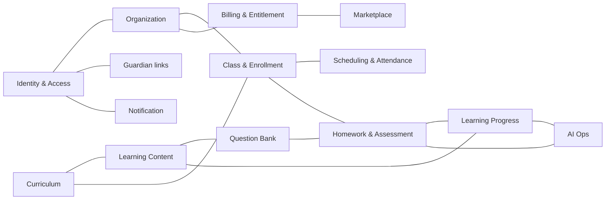
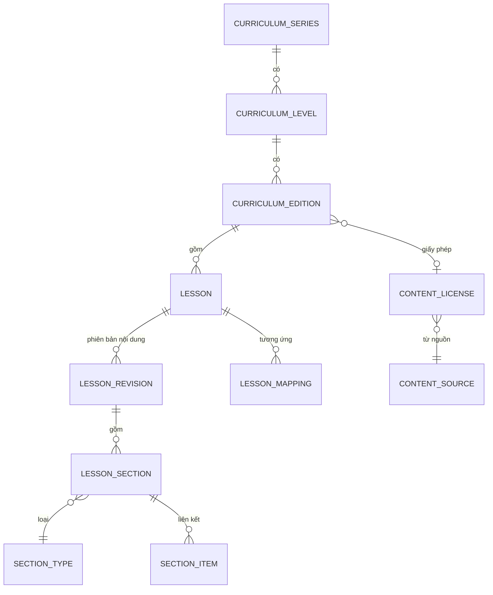

# 05 · Database Overview – TH – Tiếng Hàn

> Trạng thái: mức khái niệm/logic, cập nhật 2026-11-25 (multi-tenant đã duyệt; rút gọn khái niệm theo yêu cầu UX). Cột **Mức** khi có: P0/P1/P2. Schema vật lý (Prisma, migration) chỉ viết sau khi được phê duyệt. PostgreSQL 16+.

---

## 1. Quy ước

| Quy ước | Nội dung |
|---|---|
| Khóa chính | `id UUID` (UUIDv7 – có thứ tự thời gian, tốt cho index) |
| Tenant | Bảng thuộc trung tâm có `organization_id NOT NULL` + RLS policy; khóa ngoại nội bộ tenant dùng khóa kép `(organization_id, id)` ở bảng quan trọng để DB tự chặn tham chiếu chéo tenant |
| Thời gian | `timestamptz` (UTC); múi giờ hiển thị lưu ở `branch.timezone`, `user.timezone`. Lịch học lưu *giờ địa phương + timezone* trong quy tắc lịch, và *timestamptz* trong buổi học đã sinh |
| Audit cột | `created_at`, `created_by`, `updated_at`, `updated_by` |
| Xóa | Không xóa cứng dữ liệu nghiệp vụ có lịch sử: `archived_at` / trạng thái. Xóa cứng chỉ cho dữ liệu tạm (staging import, file mồ côi) và yêu cầu xóa dữ liệu cá nhân hợp lệ (ẩn danh hóa) |
| Bất biến | Bảng `*_version`, `*_history`, `submission_attempt` (sau khi nộp), `grade_event`, `attendance_event`, `audit_log` chỉ INSERT |
| Tiền | `amount_minor BIGINT` + `currency CHAR(3)`; không dùng float |
| Văn bản Hàn | Lưu dạng NFC; cột chuẩn hóa phục vụ tìm/trùng (`normalized_*`), index `pg_trgm` |
| Rich content | TipTap JSON trong `JSONB`, kèm `plain_text` để tìm kiếm và gửi AI |
| Enum | PostgreSQL enum cho trạng thái ổn định; bảng danh mục cho thứ cấu hình được (loại thành phần bài, loại lỗi, dạng câu hỏi) |
| Khóa lạc quan | Cột `version INT` trên bản ghi chỉnh sửa đồng thời (nháp bài làm, điểm, buổi học) |

---

## 2. Bản đồ domain

---

## 3. Identity & Access

| Bảng | Cột chính | Ràng buộc / ghi chú |
|---|---|---|
| `user` | id, display_name, date_of_birth?, locale, timezone, status (`ACTIVE`, `LOCKED`, `DEACTIVATED`), token_version | Một người thật |
| `user_identity` | id, user_id, type (`PHONE`, `EMAIL`, `USERNAME`, `GOOGLE`), value, normalized_value, verified_at | **UNIQUE (type, normalized_value)** → chống trùng tài khoản |
| `password_credential` | user_id, hash (Argon2id), must_change, changed_at | 1–1 với user |
| `session` | id, user_id, refresh_hash, device, ip, expires_at, revoked_at | |
| `role` | id, code (`SUPER_ADMIN`, `CENTER_ADMIN`, `TEACHER`, `STUDENT`; sau MVP: `CONTENT_CREATOR`) | Danh mục. Phụ huynh không phải role gán tay – suy ra từ `guardian_link`. Quyền "kiểm duyệt học liệu trung tâm" là một permission gán thêm, không phải vai trò mới |
| `permission`, `role_permission` | code (`class.write`, `homework.grade`, …) | |
| `role_assignment` | id, user_id, role_id, organization_id?, branch_id?, valid_from, valid_to, status | **UNIQUE (user_id, role_id, organization_id, branch_id)** khi đang hiệu lực |
| `guardian_link` | id, guardian_user_id, student_user_id, relationship, status (`PENDING`, `ACTIVE`, `REJECTED`, `REVOKED`), verified_by, consent_by, consent_at, revoked_by, revoked_at, reason | UNIQUE (guardian, student) khi ACTIVE; mọi thay đổi ghi `guardian_link_event` |
| `audit_log` | id, at, actor_user_id, organization_id?, action, resource_type, resource_id, before JSONB?, after JSONB?, ip, request_id | Chỉ INSERT; phân vùng theo tháng |

---

## 4. Organization

| Bảng | Cột chính | Ghi chú |
|---|---|---|
| `organization` | id, code, name, legal_name?, logo_media_id?, contact, status, settings JSONB (AI bật/tắt, cửa sổ sửa điểm danh, …) | Tenant (trung tâm) |
| `branch` | id, organization_id, name, address, timezone, status | Cơ sở |
| `room` | id, organization_id, branch_id, name, capacity, status | Phòng học |
| `organization` (bổ sung) | limits JSONB (số HV, số GV, hạn mức AI), valid_until | Giới hạn do Super Admin đặt tay; không có bảng gói riêng trong MVP |
| `organization_curriculum` | organization_id, edition_id, granted_by, granted_at, valid_until? | **Giáo trình được cấp cho trung tâm** (MVP); khái niệm quyền sử dụng tổng quát chỉ thêm ở Phase 6 |

---

## 5. Curriculum

| Bảng | Cột chính | Ghi chú |
|---|---|---|
| `curriculum_series` | id, code (`TH`, `KIIP`, `TOPIK`…), name_vi, name_ko, structure_kind (`LANGUAGE`, `SOCIETY`, `EXAM`), status | Mã là dữ liệu, không hằng số trong code |
| `curriculum_level` | id, series_id, code (`TH01`…), name_vi, name_ko, sort_order, status | UNIQUE (series_id, code) |
| `curriculum_edition` | id, level_id, name, publish_year?, isbn?, source_id, license_id, status, effective_from | Lớp gắn vào edition |
| `lesson` | id, edition_id, number, code, title_vi, title_ko, topic, sort_order, current_revision_id | UNIQUE (edition_id, number) |
| `lesson_revision` | id, lesson_id, revision_no, status (`DRAFT`, `IN_REVIEW`, `PUBLISHED`, `RETIRED`), objectives JSONB, reviewed_by, published_at | Bất biến sau PUBLISHED |
| `section_type` | code (`VOCAB`, `GRAMMAR`, `DIALOGUE`, `SOCIETY_TOPIC`…), name_vi, name_ko, allowed_item_kinds | Danh mục cấu hình |
| `lesson_section` | id, lesson_revision_id, section_type_code, title, body JSONB, sort_order | |
| `section_item` | id, section_id, item_kind (`VOCAB_SENSE`, `GRAMMAR_POINT`, `MEDIA`, `QUESTION_SET`, `ASSESSMENT`, `SOCIETY_TOPIC`), item_id, sort_order, display_overrides JSONB | Liên kết, không sao chép |
| `lesson_mapping` | id, from_lesson_id, to_lesson_id, note | **P2** – chỉ khi lớp đổi phiên bản giữa khóa |
| `content_source` | id, kind (`TEXTBOOK`, `ORIGINAL`, `AI_ASSISTED`, `PUBLIC_DOC`, `CREATOR`), title, publisher, author, url?, note | |
| `content_license` | id, source_id, rights_holder, license_type, allowed_channels (`CLASS_INTERNAL`, `B2C`, `MARKETPLACE`)[], territory?, valid_from, valid_to, document_media_id? | Chặn phân phối ngoài phạm vi |

---

## 6. Learning Content

| Bảng | Cột chính | Ghi chú |
|---|---|---|
| `vocab_entry` | id, owner_scope (`PLATFORM`, `ORGANIZATION`, `PERSONAL`), organization_id?, owner_user_id?, headword_ko, normalized_headword, pos, pronunciation?, romanization?, irregular_type?, audio_media_id?, source_id, license_id?, status | UNIQUE (owner_scope, owner, normalized_headword, pos) — gợi ý trùng xuyên tầng bằng `pg_trgm` |
| `vocab_sense` | id, entry_id, meaning_vi, meanings JSONB (ngôn ngữ khác), usage_context, image_media_id?, sort_order | Đơn vị học/SRS |
| `vocab_example` | id, sense_id, sentence_ko, translation_vi, audio_media_id? | |
| `vocab_relation` | sense_id, related_sense_id, kind (`SYNONYM`, `ANTONYM`, `RELATED`) | |
| `grammar_point` | id, owner_scope…, name_ko, normalized_name, meaning_vi, formula, conjugation_rules JSONB (V/A/N, patchim, bất quy tắc), notes, common_mistakes JSONB, status | |
| `grammar_example` | id, grammar_point_id, sentence_ko, translation_vi, highlight JSONB, audio_media_id? | |
| `grammar_contrast` | grammar_a_id, grammar_b_id, explanation, comparison_table JSONB | Phân biệt cấu trúc tương tự |
| `society_topic` | id, series_id?, category (giao thông, y tế, pháp luật…), title, body JSONB, source_id, **source_updated_at NOT NULL khi category thuộc pháp luật/chính sách/thủ tục**, review_due_at | KIIP5 |
| `media_asset` | id, owner_scope…, kind (`AUDIO`, `IMAGE`, `VIDEO`, `PDF`, `DOC`), storage_key, mime, size, duration_ms?, is_tts, tts_voice?, source_id, license_id?, status (`PENDING`, `READY`, `REJECTED`) | Bucket private |
| `content_review` | id, item_kind, item_id, revision, submitted_by, reviewer_id, decision, comment, at | Lịch sử kiểm duyệt |
| `knowledge_tag` | item_kind, item_id, tag_kind (`VOCAB_SENSE`, `GRAMMAR_POINT`, `SKILL`, `TOPIC`), tag_id | Nối câu hỏi/lỗi với kiến thức |

---

## 7. Question Bank và đề

| Bảng | Cột chính | Ghi chú |
|---|---|---|
| `question` | id, owner_scope…, current_version_id, status, created_by | Danh tính câu hỏi |
| `question_version` | id, question_id, version_no, type (`SINGLE_CHOICE`, `MULTI_CHOICE`, `TRUE_FALSE`, `MATCHING`, `FILL_BLANK`, `ORDERING`, `SHORT_ANSWER`, `ESSAY`, `TRANSLATION`, `AUDIO_RESPONSE`, `FILE_UPLOAD`, `COMPOSITE`), skill, difficulty, prompt JSONB, media_ids[], options JSONB, **answer_key JSONB**, matching_rules JSONB (NFC, bỏ khoảng cách, bỏ dấu câu), explanation JSONB, rubric_id?, default_points, curriculum refs (edition_id, lesson_id), source_id, author_id, review_status, ai_generated BOOL | **Bất biến** sau khi được dùng trong đề đã phát hành; sửa = version mới |
| `rubric`, `rubric_criterion` | criterion name, max_points, level descriptors JSONB | Có phiên bản như câu hỏi |
| `question_set` | id, owner_scope…, kind (`PRACTICE`, `ASSESSMENT`, `MOCK_EXAM`), title, curriculum refs, exam_blueprint_version_id?, status | Bộ luyện tập / đề |
| `question_set_item` | set_id, question_version_id, section_no, sort_order, points | Tham chiếu **phiên bản** cụ thể |
| `exam_blueprint`, `exam_blueprint_version` | code (`TOPIK1`, `TOPIK2`, `KIIP_MID`, …), sections JSONB (kỹ năng, số câu, thời lượng, điểm), scoring JSONB (quy đổi cấp), effective_from | Không hardcode cấu trúc đề |

---

## 8. Class & Enrollment

| Bảng | Cột chính | Ghi chú |
|---|---|---|
| `class` | id, organization_id, branch_id, code, name, edition_id, start_date, planned_sessions, start_lesson_id, sessions_per_lesson, expected_end_date (tính), default_room_id?, status (`PLANNED`, `ACTIVE`, `COMPLETED`, `CANCELLED`), tuition_amount? (một con số tham chiếu), display_config JSONB (P2: ẩn/sắp xếp thành phần bài) | |
| `class_teacher` | id, organization_id, class_id, teacher_user_id, valid_from, valid_to | Lịch sử phân công (trợ giảng: P2) |
| `enrollment` | id, organization_id, class_id, student_user_id, status (`ACTIVE`, `ON_HOLD`, `TRANSFERRED`, `WITHDRAWN`, `COMPLETED`), joined_at, left_at?, transferred_to_enrollment_id?, hold_from?, hold_until? | UNIQUE (class_id, student_user_id) khi ACTIVE; `enrollment_event` lưu lịch sử |
| `class_edition_change` | id, class_id, from_edition_id, to_edition_id, mapped_lesson_id, effective_at, by | **P2** – đổi phiên bản giữa khóa |
| `student_group` | id, organization_id, class_id, name; `student_group_member` | **P2** – giao bài theo nhóm |

> Đã bỏ bảng *kế hoạch giáo trình* và *tiến độ bài của lớp* riêng: bài dự kiến nằm trên từng buổi học (`class_session.planned_lesson_id`), tiến độ lớp **tính từ** nội dung buổi đã dạy → ít khái niệm, không lệch dữ liệu.

---

## 9. Scheduling & Attendance

| Bảng | Cột chính | Ghi chú |
|---|---|---|
| `schedule_rule` | id, organization_id, class_id, weekdays[], local_start_time, local_end_time, timezone, room_id, teacher_user_id?, valid_from, valid_to | Lịch cố định |
| `class_session` | id, organization_id, class_id, session_no, starts_at, ends_at, room_id, teacher_user_id, kind (`REGULAR`, `MAKEUP`, `EXAM`, `EXTRA`), status (`SCHEDULED`, `COMPLETED`, `CANCELLED`), planned_lesson_id?, makeup_for_session_id?, cancel_reason?, version | Exclusion constraint (`btree_gist`) chống trùng phòng và trùng giáo viên theo khoảng thời gian cho buổi chưa hủy |
| `session_change` | id, session_id, change_type, before JSONB, after JSONB, reason, by, at | Lịch sử đổi lịch |
| `attendance` | id, organization_id, session_id, student_user_id, status (`PRESENT`, `ABSENT`, `LATE`, `EXCUSED`), note, recorded_by, recorded_at, version | UNIQUE (session_id, student_user_id); thay đổi ghi `attendance_event` |
| `session_log` | id, session_id, lessons_taught (lesson_id, `DONE`/`PARTIAL`)[], note, attachments media_ids[] (P1), created_by | Nội dung buổi học |
| `student_comment` | id, organization_id, student_user_id, class_id, session_id?, author_id, body, visibility (`TEACHER_ONLY`, `STUDENT`, `STUDENT_AND_GUARDIAN`), published_at? | Nhận xét HV |

---

## 10. Homework & Assessment

Kế thừa thiết kế Homework Management System; điều chỉnh cho câu hỏi có phiên bản và chế độ học.

| Bảng | Cột chính | Ghi chú |
|---|---|---|
| `assignment` | id, organization_id, class_id?, created_by, title, instructions, question_set_id (snapshot), mode (`PRACTICE`, `HOMEWORK`, `QUIZ`, `MOCK_EXAM`), curriculum refs, skill[], open_at, due_at, late_until?, duration_min?, max_attempts, score_policy (`LAST`, `HIGHEST`), completion_rule JSONB, answer_visibility (`NEVER`, `AFTER_SUBMIT`, `AFTER_DUE`, `AFTER_PUBLISH`), ai_assist_allowed BOOL, listen_limit?, status (`DRAFT`, `PUBLISHED`, `REVOKED`, `ARCHIVED`), published_at | Khi PUBLISHED, `question_set` bị khóa |
| `assignment_target` | assignment_id, target_kind (`CLASS`, `GROUP`, `STUDENT`), target_id | |
| `assignment_recipient` | id, organization_id, assignment_id, student_user_id, enrollment_id, due_at_override?, status_cache | UNIQUE (assignment_id, student_user_id) → nhận một lần |
| `submission_attempt` | id, organization_id, recipient_id, attempt_no, status (`IN_PROGRESS`, `SUBMITTED`, `GRADING`, `GRADED`, `PUBLISHED`, `RETURNED`), started_at, deadline_at, submitted_at?, is_late, applied_due_at, auto_submitted, idempotency_key, draft_version | UNIQUE (recipient_id, attempt_no); UNIQUE (idempotency_key) |
| `response` | id, attempt_id, question_version_id, answer JSONB, media_ids[], saved_at | Bất biến sau SUBMITTED |
| `grade` | id, organization_id, response_id, source (`AUTO`, `AI`, `TEACHER`), points, max_points, criteria JSONB, feedback, status (`PENDING`, `AUTO_GRADED`, `AI_SUGGESTED`, `TEACHER_APPROVED`), approved_by, version | Điểm chính thức = bản ghi TEACHER_APPROVED hoặc AUTO_GRADED |
| `grade_event` | id, grade_id, before, after, reason, by, at | Chỉ INSERT |
| `attempt_result` | attempt_id, total_points, max_points, published_at?, published_by? | |
| `practice_session` | id, user_id, organization_id?, context (`CLASS`, `SELF`), question_set_id?, started_at, finished_at, summary JSONB | Luyện tập ngoài bài tập (không qua công bố) |
| `practice_answer` | id, practice_session_id, question_version_id, answer JSONB, is_correct, feedback JSONB, at | |

---

## 11. Learning Progress

| Bảng | Cột chính | Ghi chú |
|---|---|---|
| `lesson_progress` | user_id, lesson_id, context_kind (`ENROLLMENT`, `SELF`), context_id, status, percent, last_section_id, updated_at | Tiến độ cá nhân theo từng ngữ cảnh → học song song hai giáo trình |
| `vocab_memory` | user_id, sense_id, state (`NEW`, `LEARNING`, `REVIEW`, `RELAPSE`), stability, difficulty, due_at, reps, lapses, last_reviewed_at, algorithm_version | **PK (user_id, sense_id)** – dùng chung mọi ngữ cảnh; index (user_id, due_at) |
| `vocab_review_log` | id, user_id, sense_id, at, exercise_type, rating/correct, elapsed_ms | Chỉ INSERT; dùng để tối ưu thuật toán |
| `notebook_item` | id, user_id, kind (`VOCAB`, `GRAMMAR`, `SENTENCE`, `NOTE`), ref_id?, body, tags[], created_at | Sổ tay cá nhân |
| `mistake_record` | id, user_id, organization_id?, source_kind (`ATTEMPT`, `PRACTICE`), source_id, question_version_id, category (`VOCAB`, `GRAMMAR`, `PARTICLE`, `CONJUGATION`, `IRREGULAR`, `SPELLING`, `SPACING`, `TRANSLATION`, `READING`, `LISTENING`, `PRONUNCIATION`, `CULTURE_SOCIETY`), knowledge refs, detail JSONB, classified_by (`RULE`, `AI`, `TEACHER`), occurred_at | Mỗi lần sai |
| `mistake_summary` | user_id, category, knowledge_ref, count, last_at, improved_at?, status (`ACTIVE`, `IMPROVING`, `RESOLVED`) | Tổng hợp cho sổ tay lỗi |
| `mastery` | user_id, knowledge_kind, knowledge_id, score, evidence_count, updated_at | **Chỉ hiển thị khi evidence_count ≥ ngưỡng cấu hình** |

> Quyền xem: dữ liệu `context_kind = SELF` không hiển thị cho trung tâm/phụ huynh trừ khi người học cho phép (D-B08). `vocab_memory` và `mistake_summary` dùng chung — báo cáo cho giáo viên chỉ tính bản ghi phát sinh trong ngữ cảnh trung tâm (`organization_id` khớp).

---

## 12. AI Ops

| Bảng | Cột chính | Ghi chú |
|---|---|---|
| `ai_provider_config` | id, task (`GRADING`, `CONTENT_GEN`, `EXPLAIN`, `TUTOR`, `REPORT_SUMMARY`, `TTS`, `SPEECH`), provider, model, params JSONB, active | Cấu hình được, không hardcode |
| `prompt_template` | id, task, version, body, output_schema JSONB, status, created_by | |
| `ai_request` | id, organization_id?, user_ref (hash), task, provider, model, prompt_version, input_hash, tokens_in, tokens_out, cost_estimate_minor, latency_ms, status (`QUEUED`, `RUNNING`, `SUCCEEDED`, `INVALID`, `FAILED`, `SKIPPED_QUOTA`, `CANCELLED`), error, raw_response_ref | Không lưu dữ liệu cá nhân dạng rõ |
| `ai_grading_result` | id, ai_request_id, response_id, criteria JSONB, total_suggested, errors JSONB, explanation_vi, rewrite_suggestion, confidence, injection_suspected | Tách biệt `grade` |
| `ai_quota` | scope (`USER`, `ORGANIZATION`, `PLAN`), scope_id, task, period, limit, used | |
| `ai_eval_case`, `ai_eval_run` | bộ bài mẫu, điểm GV, kết quả từng lần chạy theo prompt/model | Đo chất lượng |

---

## 13. Notification, Import, hệ thống

| Bảng | Cột chính | Ghi chú |
|---|---|---|
| `outbox_event` | id, type, payload JSONB, organization_id?, created_at, processed_at? | Ghi trong cùng transaction nghiệp vụ |
| `notification` | id, user_id, organization_id?, type, title, body, link, data JSONB, read_at?, created_at | Index (user_id, read_at, created_at) |
| `notification_preference` | user_id, type, channel, enabled, quiet_hours | |
| `notification_delivery` | notification_id, channel, status, attempts, last_error | Cho kênh ngoài (sau MVP) |
| `import_job` | id, organization_id?, kind, target_scope, template_version, file_media_id, status (`UPLOADED`, `VALIDATING`, `PREVIEW_READY`, `COMMITTED`, `FAILED`, `CANCELLED`, `ROLLED_BACK`), stats JSONB, created_by | |
| `import_row` | id, job_id, row_no, raw JSONB, normalized JSONB, errors JSONB, duplicate_of?, decision (`CREATE`, `MERGE`, `SKIP`), created_ref? | Staging – xóa sau N ngày |
| `system_setting` | key, value JSONB, updated_by | Cấu hình nền tảng |

---

## 14. Billing, Entitlement, Marketplace (Phase 6–7, phác thảo)

| Bảng | Mục đích | Phase |
|---|---|---|
| `entitlement` | Quyền sử dụng tổng quát (khóa học, gói, sản phẩm đã mua) – thay thế/mở rộng `organization_curriculum` | 6 |
| `product`, `product_version`, `price` | Khóa học, gói, sản phẩm học liệu; giá cấu hình, nhiều mức (Basic/Premium) | 6 |
| `order`, `order_item`, `payment`, `refund` | Đơn hàng và thanh toán (cổng thanh toán: D-B13) | 6 |
| `subscription` | Thuê bao tháng/năm | 6 |
| `tuition_invoice` | Học phí trung tâm (tách khỏi doanh thu nền tảng) | 6 |
| `seller`, `revenue_share_rule`, `ledger_entry`, `settlement`, `payout` | Chia sẻ doanh thu; sổ cái bất biến; đối soát tháng | 7 |
| `product_review` | Đánh giá sản phẩm | 7 |

Tài chính tách theo dòng: học phí trung tâm · khóa online · thuê bao phần mềm · Marketplace · chi phí AI · chia sẻ doanh thu. Không hardcode giá, tỷ lệ, hoàn tiền.

---

## 15. Index và ràng buộc trọng yếu

| Mục đích | Index/ràng buộc |
|---|---|
| Lịch hôm nay của trung tâm/GV | `class_session (organization_id, starts_at)`, `(teacher_user_id, starts_at)` |
| Chống trùng phòng/GV | `EXCLUDE USING gist (room_id WITH =, tstzrange(starts_at, ends_at) WITH &&) WHERE status <> 'CANCELLED'` (tương tự cho teacher) |
| Bài tập của HV | `assignment_recipient (student_user_id, organization_id)`, `assignment (class_id, due_at)` |
| Hàng chờ chấm của GV | `grade (organization_id, status)` partial index `WHERE status IN ('PENDING','AI_SUGGESTED')` |
| Ôn từ đến hạn | `vocab_memory (user_id, due_at)` |
| Tìm từ/ngữ pháp | GIN `pg_trgm` trên `normalized_headword`, `normalized_name`; FTS trên `plain_text` |
| Nộp bài idempotent | UNIQUE `submission_attempt (idempotency_key)`, `(recipient_id, attempt_no)` |
| Một tài khoản / định danh | UNIQUE `user_identity (type, normalized_value)` |
| Cách ly tenant | RLS trên mọi bảng có `organization_id`; khóa ngoại kép `(organization_id, id)` cho `class`, `enrollment`, `class_session`, `assignment` |

---

## 16. Lưu giữ và quyền riêng tư dữ liệu

| Dữ liệu | Lưu giữ đề xuất (D-B14) |
|---|---|
| Bài nộp, điểm, điểm danh | Suốt thời gian hợp đồng với trung tâm + thời hạn theo quy định; khi trung tâm chấm dứt: xuất dữ liệu rồi xóa/ẩn danh |
| Log AI (bản thô) | Ngắn hạn (vd. 90 ngày) — chỉ giữ kết quả có cấu trúc |
| Staging import, file mồ côi | 7–30 ngày |
| Audit log | Dài hạn (vd. ≥ 2 năm) |
| Yêu cầu xóa của người dùng | Ẩn danh hóa thông tin định danh; giữ số liệu tổng hợp |
