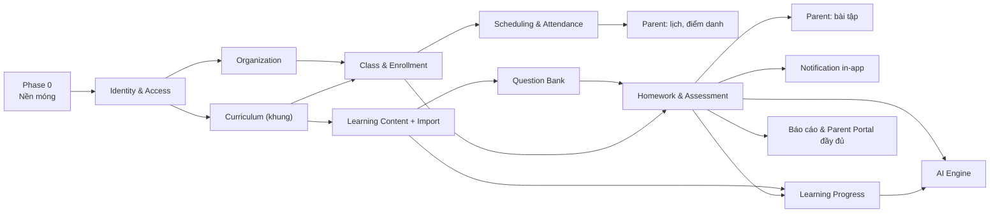
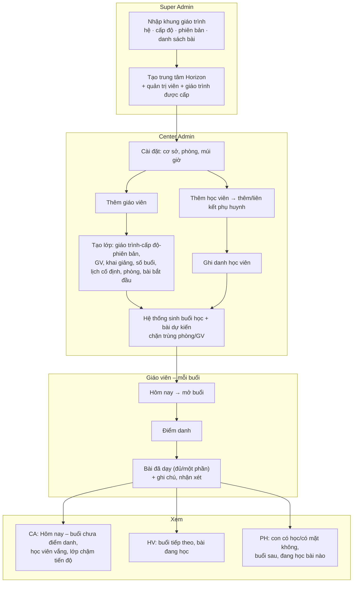

# 06 · MVP Development Roadmap – TH – Tiếng Hàn

> Trạng thái: cập nhật theo phê duyệt ngày 2026-11-25 · **MVP = Phase 1–4** · Horizon là môi trường kiểm nghiệm đầu tiên.
> Không ước lượng thời gian cố định; lịch cụ thể lập sau khi chốt các quyết định bắt buộc ở [07](07-decisions-pending.md).

---

## 1. Định hướng đã phê duyệt

| # | Nội dung | Ảnh hưởng đến lộ trình |
|---|---|---|
| A1 | **D-B15**: tài khoản phụ huynh, liên kết PH–HV, xem lịch học và điểm danh ở **Phase 1**; PH xem tình trạng làm bài **ngay khi Phase 2 có giao bài** | PH-01, PH-02 vào Phase 1; PH-03 vào Phase 2 (trước là Phase 4) |
| A2 | **Learning Progress** là module độc lập, không phụ thuộc AI | Ôn từ vựng, sổ tay, sổ tay lỗi (theo quy tắc) chạy từ Phase 2 |
| A3 | **Multi-tenant + Modular Monolith**, không microservices giai đoạn đầu | Áp dụng từ Phase 0 |
| A4 | Tái sử dụng có chọn lọc phân tích Homework cũ | Thay bằng [08-homework-assessment.md](08-homework-assessment.md); bản cũ lưu trữ |
| A5 | Hai hệ giáo trình chính thức TH và KIIP; **đủ cấu trúc cấp độ, không tự tạo nội dung** | Phase 1 chỉ có khung; nội dung nhập khi có dữ liệu và quyền |
| A6 | Không Marketplace, thanh toán trực tuyến, thương mại hóa nâng cao trong MVP | Phase 6–7 giữ nguyên ngoài MVP |
| A7 | UX: ít chữ, thao tác đơn giản, icon đồng bộ, mobile first cho HV/PH, gộp màn hình, không thêm khái niệm thừa | Danh mục màn hình rút từ ~60 xuống **44**, trong đó **28 P0** |

---

## 2. Tổng quan phase

| Phase | Tên | Kết quả đo được | Điều kiện bắt đầu |
|---|---|---|---|
| 0 | Nền móng kỹ thuật | Repo, CI, môi trường, khung đăng nhập/phân quyền/cách ly trung tâm, giao diện nền | Các quyết định bắt buộc ([07 §2](07-decisions-pending.md#2-quyết-định-còn-lại)) |
| 1 | Training Management Foundation | Horizon chạy **1–2 lớp thật**: lớp, lịch, điểm danh, nội dung buổi, tiến độ; **PH xem lịch & điểm danh** | Phase 0 + khung giáo trình do chủ sản phẩm nhập |
| 2 | Core Learning & Homework | Giao/làm/nộp/chấm/công bố bài theo bài giáo trình; **PH xem tình trạng bài**; ôn từ, sổ tay; thông báo in-app | Phase 1 + D-B07, D-B09, D-B11 + (để có nội dung) D-B01 |
| 3 | AI Assessment & Personalized Learning | AI soạn đề & chấm đề xuất dịch/viết đạt ngưỡng lệch với GV; sổ tay lỗi AI; ôn thích ứng | Phase 2 + D-B12, D-T06 + bộ đánh giá AI |
| 4 | Parent Portal & Analytics | PH xem kết quả & báo cáo tuần/tháng; báo cáo chất lượng trung tâm/GV | Phase 2 |
| 5–7 | Ngoài MVP | Tự học B2C, luyện thi, AI Tutor, phát âm · Thương mại hóa · Marketplace | MVP ổn định |

Đường găng: Identity → Organization → Curriculum khung → Class → Scheduling → (Phase 2) Content → Question Bank → Homework → (Phase 3) AI.

---

## 3. Danh mục màn hình MVP và mức ưu tiên

**Định nghĩa:** **P0** – bắt buộc để vận hành phase đó · **P1** – cần ngay sau khi P0 hoàn thành · **P2** – phát triển sau.
Trạng thái lỗi 403/404/500, loading/empty là trạng thái chung, không tính là màn hình.

| Mã | Màn hình | Gộp từ (danh mục cũ) | Vai trò | Phase | Mức |
|---|---|---|---|---|---|
| C-01 | Đăng nhập | S-AUTH-01 | Tất cả | 1 | **P0** |
| C-02 | Đặt mật khẩu | S-AUTH-02, S-AUTH-03 | Tất cả | 1 | **P0** |
| C-03 | Tài khoản (hồ sơ, mật khẩu, chuyển vai trò, liên kết) | S-AUTH-04, S-CM-01, S-PA-03 | Tất cả | 1 | **P0** |
| C-05 | Trang công khai + điều khoản/chính sách dữ liệu | S-PUB-01, S-PUB-02 | Khách | 1 | **P0** |
| C-07 | Import (người dùng / học liệu) | S-SA-09, import HV | SA, CA | 1 / 2 | P1 / **P0** |
| C-04 | Thông báo | S-CM-03 | Tất cả | 2 | P1 |
| C-06 | Trang chương trình chi tiết | — | Khách | 5 | P2 |
| SA-01 | Trung tâm | S-SA-02 | Super Admin | 1 | **P0** |
| SA-02 | Giáo trình (hệ → cấp độ → phiên bản → bài, nguồn & quyền) | S-SA-04, S-SA-05 | Super Admin | 1 | **P0** |
| SA-03 | Người dùng | S-SA-03 | Super Admin | 1 | P1 |
| SA-04 | Nhật ký hệ thống | S-SA-06 (phần) | Super Admin | 1 | P1 |
| SA-05 | Kho học liệu (+ lọc "Chờ duyệt") | S-SA-07, S-SA-10 | Super Admin | 2 | **P0** |
| SA-06 | Biên tập bài học | S-SA-08 | Super Admin | 2 | **P0** |
| SA-09 | AI: bật/tắt, hạn mức, chi phí | S-SA-11 | Super Admin | 3 | P1 |
| SA-08 | Tổng quan nền tảng | S-SA-01 | Super Admin | 4 | P2 |
| SA-10 | Cấu hình nền tảng | S-SA-06 (phần) | Super Admin | — | P2 |
| CA-01 | Hôm nay (trung tâm) | S-CA-01 | Center Admin | 1 | **P0** |
| CA-02 | Lớp học (danh sách + form lớp) | S-CA-06 | Center Admin | 1 | **P0** |
| CA-03 | Chi tiết lớp (Học viên · Buổi học · Tiến độ · Bài tập · Kết quả) | S-CA-07, S-T-04 | Center Admin (+ GV) | 1 | **P0** |
| CA-04 | Học viên (+ phụ huynh) | S-CA-04, S-CA-05 | Center Admin | 1 | **P0** |
| CA-05 | Giáo viên | S-CA-03 | Center Admin | 1 | **P0** |
| CA-08 | Cài đặt (trung tâm, cơ sở & phòng) | S-CA-02 | Center Admin | 1 | **P0** |
| CA-06 | Lịch trung tâm | S-CA-08 | Center Admin | 1 | P1 |
| CA-07 | Báo cáo | S-CA-09, S-CA-11 | Center Admin | 1→4 | P1 |
| T-01 | Hôm nay (giáo viên, gồm lịch dạy) | S-T-01, S-T-02 | Teacher | 1 | **P0** |
| T-02 | Buổi học (điểm danh, bài đã dạy, nhận xét, giao bài sau buổi) | S-T-03 | Teacher | 1 | **P0** |
| T-03 | Lớp của tôi (dùng lại CA-03) | S-T-04 | Teacher | 1 | P1 |
| T-04 | Học liệu & câu hỏi | S-T-05, S-T-06, S-T-12 | Teacher (+ CA) | 2 | **P0** |
| T-05 | Bài tập (danh sách + giao + theo dõi) | S-T-07, S-T-08 | Teacher | 2 | **P0** |
| T-06 | Chấm bài (hàng chờ + workspace) | S-T-09, S-T-10 | Teacher | 2 | **P0** |
| T-07 | Báo cáo lớp | S-T-11, S-T-13 | Teacher | 2→4 | P1 |
| HV-01 | Hôm nay (học viên) | S-ST-01, S-ST-03 | Student | 1 | **P0** |
| HV-02 | Lịch học | S-ST-02 | Student | 1 | P1 |
| HV-03 | Học tập (giáo trình → bài) | S-ST-04 | Student | 2 | **P0** |
| HV-04 | Bài học (từ vựng, ngữ pháp dạng panel) | S-ST-05, S-ST-07 | Student | 2 | **P0** |
| HV-05 | Bài tập | S-ST-08 | Student | 2 | **P0** |
| HV-06 | Làm bài / kết quả | S-ST-09, S-ST-10 | Student | 2 | **P0** |
| HV-07 | Ôn từ vựng | S-ST-06 | Student | 2 | P1 |
| HV-08 | Sổ tay (+ sổ tay lỗi, luyện lại) | S-ST-11, S-ST-13 | Student | 2 | P1 |
| HV-09 | Kết quả & tiến độ | S-ST-12 | Student | 2 | P1 |
| PH-01 | Hôm nay của con | S-PA-01 | Parent | 1 | **P0** |
| PH-02 | Lịch & điểm danh | S-PA-02 | Parent | 1 | **P0** |
| PH-03 | Bài tập của con | S-PA-04 | Parent | **2** | **P0** |
| PH-04 | Kết quả & báo cáo | S-PA-05 | Parent | 4 | P1 |

**Tổng: 44 màn hình — P0: 28 · P1: 13 · P2: 3** (C-07 tính một lần, ở mức P0).

| Phase | P0 | P1 | P2 |
|---|---|---|---|
| 1 | 17 | 7 (C-07 người dùng, SA-03, SA-04, CA-06, CA-07, T-03, HV-02) | — |
| 2 | 11 (C-07 học liệu, SA-05, SA-06, T-04, T-05, T-06, HV-03…06, PH-03) | 5 (C-04, T-07, HV-07, HV-08, HV-09) | — |
| 3 | — (bổ sung panel AI vào T-04, T-06) | 1 (SA-09) | — |
| 4 | — (mở rộng CA-01, CA-03, CA-07, T-07) | 1 (PH-04) | 1 (SA-08) |
| Sau | — | — | 2 (C-06, SA-10) |

> Các chức năng đã **bỏ khỏi MVP** do gộp/không cần: màn hình kiểm duyệt riêng, màn hình phụ huynh riêng ở trung tâm, menu Chương trình & Tài chính của trung tâm, wizard tạo lớp/giao bài, màn hình chọn ngữ cảnh riêng, màn hình kết quả bài riêng.

---

## 4. Phase 1 – Training Management Foundation (chi tiết)

### 4.1 Phạm vi

| Nhóm | Trong Phase 1 | Mức |
|---|---|---|
| Tài khoản | Đăng nhập SĐT/email + mật khẩu; tài khoản do trung tâm tạo với **mật khẩu tạm, bắt buộc đổi ở lần đầu**; quên mật khẩu qua email (nếu có email) hoặc trung tâm đặt lại; khóa tài khoản; một người nhiều vai trò + chuyển vai trò | P0 |
| Phân quyền | Super Admin, Center Admin, Teacher, Student, Parent; kiểm tra ở backend theo trung tâm và theo tài nguyên; audit log các thao tác quan trọng | P0 |
| Nền tảng | Tạo trung tâm, quản trị viên trung tâm, giới hạn số người dùng, **cấp giáo trình cho trung tâm** | P0 |
| Giáo trình | Hai hệ **TH** và **KIIP** với đủ cấp độ (TH01–TH06, KIIP00–KIIP05-A/B); phiên bản giáo trình (nguồn, quyền sử dụng); **danh sách bài do chủ sản phẩm nhập** — không có nội dung bài | P0 |
| Trung tâm | Cơ sở (múi giờ), phòng; giáo viên; học viên; phụ huynh tạo và liên kết từ hồ sơ học viên | P0 |
| Lớp học | Tạo lớp: cơ sở, giáo trình–cấp độ–phiên bản, GV, khai giảng, số buổi, lịch cố định, phòng, học phí (một con số tham chiếu), bài bắt đầu; ghi danh; chuyển lớp; bảo lưu; đổi GV | P0 |
| Lịch | Sinh buổi học từ lịch cố định; **chặn trùng phòng/GV**; đổi giờ một buổi; nghỉ (có/không học bù); thêm buổi học bù/kiểm tra | P0 |
| Buổi học | Điểm danh (có mặt, vắng, đi muộn, vắng có phép); bài đã dạy (hoàn thành/một phần); ghi chú buổi; nhận xét học viên (hiển thị cho HV và PH khi GV chọn) | P0 |
| Tiến độ | Mỗi buổi có **bài dự kiến** (tự gợi ý theo bài bắt đầu và số buổi/bài, sửa được); tiến độ lớp = bài đã dạy; cảnh báo lớp chậm ≥ ngưỡng | P0 |
| Học viên | Hôm nay: buổi tiếp theo, giáo trình/bài đang học | P0 |
| Phụ huynh | Hôm nay của con; lịch & điểm danh; nhiều con | P0 |
| Website | Trang công khai tối giản + điều khoản + chính sách dữ liệu | P0 |
| Sau P0 | Import người dùng từ Excel, lịch trung tâm, báo cáo chuyên cần (+ xuất Excel: P2), SA người dùng & nhật ký, lớp của tôi cho GV, lịch học viên | P1 |

**Không thuộc Phase 1:** nội dung bài học, bài tập, thông báo (Phase 2 – in-app), AI, báo cáo tuần/tháng, thanh toán, Zalo/SMS.

### 4.2 Màn hình Phase 1

| Mức | Màn hình |
|---|---|
| **P0 (17)** | C-01 Đăng nhập · C-02 Đặt mật khẩu · C-03 Tài khoản · C-05 Trang công khai · SA-01 Trung tâm · SA-02 Giáo trình · CA-01 Hôm nay · CA-02 Lớp học · CA-03 Chi tiết lớp · CA-04 Học viên · CA-05 Giáo viên · CA-08 Cài đặt · T-01 Hôm nay · T-02 Buổi học · HV-01 Hôm nay · PH-01 Hôm nay của con · PH-02 Lịch & điểm danh |
| P1 (7) | C-07 Import người dùng · SA-03 Người dùng · SA-04 Nhật ký · CA-06 Lịch trung tâm · CA-07 Báo cáo chuyên cần · T-03 Lớp của tôi · HV-02 Lịch học |

### 4.3 Luồng nghiệp vụ Phase 1

**Luồng thay đổi (dạng hộp thoại trong CA-03):**

| Thao tác | Kết quả |
|---|---|
| Đổi giờ/phòng một buổi | Buổi giữ nguyên, ghi lịch sử thay đổi; kiểm tra trùng |
| Nghỉ một buổi | Buổi → *Đã hủy* + lý do; tùy chọn tạo **buổi học bù** liên kết buổi gốc |
| Thêm buổi kiểm tra/học thêm | Buổi mới loại *Kiểm tra*/*Học thêm* |
| Đổi giáo viên (từ ngày) | Các buổi từ ngày đó chuyển GV mới; GV cũ mất quyền với lớp từ ngày đó |
| Chuyển lớp | Ghi danh cũ → *Đã chuyển*, ghi danh mới ở lớp đích từ ngày hiệu lực; lịch sử điểm danh giữ nguyên |
| Bảo lưu / quay lại | Ghi danh → *Bảo lưu* (không tính vắng); quay lại → *Đang học* |
| Thu hồi liên kết phụ huynh | Có hiệu lực ngay; ghi audit |

### 4.4 Quy tắc nghiệp vụ Phase 1

| Mã | Quy tắc | Trạng thái |
|---|---|---|
| R1-01 | Lớp gắn đúng **một phiên bản giáo trình** của một cấp độ, chỉ chọn trong giáo trình trung tâm được cấp | Theo thiết kế |
| R1-02 | Một học viên có thể học nhiều lớp (vd. TH02 và KIIP01); tiến độ tách theo lớp | Theo thiết kế |
| R1-03 | Không cho tạo buổi trùng phòng hoặc trùng giáo viên (cảnh báo và chặn) | Theo thiết kế |
| R1-04 | Giờ học lưu theo múi giờ của cơ sở | Theo thiết kế |
| R1-05 | GV sửa điểm danh trong **48 giờ** sau buổi; sau đó chỉ Center Admin sửa, có lý do | Mặc định chờ duyệt (D-B19) |
| R1-06 | Lớp "chậm tiến độ" khi bài đã dạy chậm hơn bài dự kiến **≥ 1 bài** | Mặc định chờ duyệt (D-B19) |
| R1-07 | Liên kết PH–HV do Center Admin tạo; HV **từ đủ 18 tuổi** phải đồng ý trong app; HV dưới 18 tuổi: Center Admin xác nhận người giám hộ | Chờ duyệt (D-B21) |
| R1-08 | Phụ huynh chỉ xem học viên có liên kết đang hiệu lực; không sửa được gì | Theo thiết kế |
| R1-09 | Không tạo trùng tài khoản: SĐT/email đã tồn tại → gắn vai trò mới vào tài khoản sẵn có (vd. phụ huynh đồng thời là học viên) | Theo thiết kế |
| R1-10 | Không xóa cứng lớp, ghi danh, buổi học, điểm danh có dữ liệu; dùng trạng thái | Theo thiết kế |

### 4.5 Tiêu chí nghiệm thu Phase 1

**A. Kịch bản xuyên suốt (thực hiện trên staging với dữ liệu thử của Horizon)**

| # | Bước | Kết quả mong đợi |
|---|---|---|
| 1 | Super Admin nhập khung TH01 (một phiên bản, danh sách bài do chủ sản phẩm cung cấp) và tạo trung tâm Horizon, cấp TH01 | Center Admin Horizon đăng nhập, chỉ thấy TH01 khi tạo lớp |
| 2 | Center Admin tạo cơ sở, 2 phòng, 2 GV, 10 HV, 8 PH (2 PH có 2 con, 1 HV ≥ 18 tuổi) | Không tạo trùng tài khoản khi SĐT đã tồn tại |
| 3 | Tạo lớp TH01, lịch thứ 2-4-6, 24 buổi, ghi danh 10 HV | Sinh đúng 24 buổi, ngày kết thúc dự kiến đúng, mỗi buổi có bài dự kiến |
| 4 | Tạo lớp thứ hai trùng phòng, trùng giờ | Bị chặn, thông báo rõ buổi bị trùng |
| 5 | GV mở buổi trên điện thoại, điểm danh 8 có mặt, 1 vắng, 1 muộn; ghi bài 1 hoàn thành | CA-01 hiện học viên vắng; tiến độ lớp = bài 1 |
| 6 | PH của học viên vắng mở app | Thấy "Vắng" ở buổi hôm nay, buổi sau, bài đang học |
| 7 | HV ≥ 18 tuổi nhận yêu cầu liên kết, từ chối | PH không xem được; CA thấy trạng thái "Bị từ chối" |
| 8 | Đổi giờ 1 buổi, nghỉ 1 buổi có học bù | HV và PH thấy lịch mới, buổi nghỉ và buổi học bù |
| 9 | Chuyển 1 HV sang lớp khác; bảo lưu 1 HV | Lịch sử điểm danh giữ nguyên; HV bảo lưu không bị tính vắng |
| 10 | Đổi GV từ một ngày | GV cũ không còn mở được buổi sau ngày đó |
| 11 | GV sửa điểm danh sau 48h | Bị từ chối; CA sửa được với lý do, có trong nhật ký |
| 12 | Thu hồi liên kết PH khi PH đang mở app | Lần tải tiếp theo PH không còn thấy học viên đó |

**B. Phân quyền và an toàn dữ liệu**

- Với **mọi API** của Phase 1: người dùng trung tâm A truy cập ID thuộc trung tâm B → 404 (test tự động).
- GV không xem được lớp không phụ trách; HV không xem được HV khác; PH chỉ xem con đã liên kết.
- Thao tác: tạo/khóa tài khoản, đổi vai trò, sửa điểm danh quá hạn, liên kết/thu hồi phụ huynh, chuyển lớp → có trong audit log.
- Mật khẩu băm an toàn; đăng nhập sai nhiều lần bị giới hạn; không có bí mật trong mã nguồn.

**C. Trải nghiệm**

- Màn hình P0 của HV, PH, T-02 dùng tốt trên điện thoại 360 px; điểm danh một lớp 15 HV ≤ 1 phút.
- Mọi màn hình có trạng thái đang tải / trống / lỗi / thành công; thông điệp tiếng Việt ngắn.
- Chỉ hiển thị menu đã triển khai.

**D. Kỹ thuật**

- Frontend nối backend thật; dữ liệu lưu và đọc lại đúng (test tích hợp với DB thật).
- CI xanh: lint, typecheck, unit, integration, E2E kịch bản A.
- Backup DB tự động và **diễn tập khôi phục** thành công trên staging.
- Tài liệu: hướng dẫn chạy dev, triển khai staging, hướng dẫn sử dụng ngắn cho CA/GV/PH.

---

## 5. Phase 2 – Core Learning & Homework

| Epic | Nội dung | Mức |
|---|---|---|
| E2.1 Kho học liệu | Từ vựng (từ/nghĩa/ví dụ), ngữ pháp, media; 3 tầng sở hữu (nền tảng/trung tâm/cá nhân); kiểm duyệt qua bộ lọc "Chờ duyệt" | P0 |
| E2.2 Nội dung bài | Thành phần bài, liên kết kiến thức, ẩn/sắp xếp theo lớp | P0 |
| E2.3 Import | Mẫu Excel/CSV, kiểm tra, phát hiện trùng, xem trước, xác nhận, kiểm duyệt, hoàn tác | P0 |
| E2.4 Câu hỏi | Câu hỏi có phiên bản; dạng P0 theo [08 §2](08-homework-assessment.md#2-dạng-câu-hỏi) | P0 |
| E2.5 Bài tập | Giao, làm, nộp, chấm tự động/thủ công, làm lại, công bố, lịch sử điểm ([08](08-homework-assessment.md)) | P0 |
| E2.6 Phụ huynh – bài tập | PH-03 + tóm tắt bài tập trên PH-01 (theo D-B15) | P0 |
| E2.7 Học viên học | HV-03, HV-04: trang bài học, từ vựng, ngữ pháp, nghe/đọc cơ bản | P0 |
| E2.8 Thông báo in-app | Bài mới, sắp hạn, quá hạn, đã nộp, cần làm lại, có điểm; **vắng mặt, đổi lịch, nghỉ** (cho Phase 1) | P1 |
| E2.9 Learning Progress | Ôn từ vựng (lịch ôn), sổ tay, sổ tay lỗi theo quy tắc, kết quả & tiến độ | P1 |
| E2.10 Báo cáo lớp | Hoàn thành, điểm TB, câu/từ hay sai | P1 |
| — | Kiểm tra có giờ, ghép nối, sắp xếp, nộp file, hẹn giờ giao | P1 |
| — | Giao theo nhóm, xáo trộn câu, quét virus file | P2 |

**Nghiệm thu Phase 2:** kịch bản xuyên suốt đến *PH xem tình trạng bài và điểm đã công bố*; import lỗi/trùng; nộp muộn, mất mạng, nộp nhiều lần; sửa bài đã giao; học đồng thời hai giáo trình; đáp án không lộ qua API trước thời điểm cho phép; PH không thấy điểm chưa công bố.

---

## 6. Phase 3 – AI Assessment & Personalized Learning

| Epic | Nội dung | Mức |
|---|---|---|
| E3.1 AI Gateway | Nhà cung cấp cấu hình được, lọc dữ liệu cá nhân, kiểm tra đầu ra, hạn mức, log chi phí, bật/tắt theo trung tâm | P0 |
| E3.2 Bộ đánh giá AI | Bài dịch/viết TH01–TH02 do GV Horizon chấm mẫu; ngưỡng lệch được duyệt | P0 |
| E3.3 AI chấm đề xuất | Dịch, viết: điểm theo tiêu chí, lỗi, giải thích tiếng Việt → GV duyệt (panel trong T-06) | P0 |
| E3.4 AI soạn học liệu | Câu hỏi/bài tập theo bài, có đáp án & giải thích → nháp → GV duyệt (panel trong T-04) | P1 |
| E3.5 Sổ tay lỗi AI & ôn thích ứng | Phân loại lỗi, luyện bổ sung theo nhóm lỗi, mức thành thạo có ngưỡng dữ liệu | P1 |
| E3.6 SA-09 | Chi phí & hạn mức AI | P1 |

**Nghiệm thu:** độ lệch AI–GV trên bộ đánh giá ≤ ngưỡng; không có điểm AI nào tự công bố; AI lỗi không làm mất bài nộp; bài kiểm tra chặn AI ở API.

---

## 7. Phase 4 – Parent Portal & Analytics

| Epic | Nội dung | Mức |
|---|---|---|
| E4.1 PH-04 | Kết quả & báo cáo tuần/tháng (số liệu thật, nhận xét GV; tóm tắt AI tùy chọn) | P1 |
| E4.2 Báo cáo trung tâm/GV | Chất lượng lớp, kỹ năng, tiến bộ, nội dung cần củng cố | P1 |
| E4.3 Xuất Excel | Báo cáo lớp/trung tâm | P2 |
| E4.4 SA-08 | Tổng quan nền tảng | P2 |

**Nghiệm thu MVP:** toàn bộ luồng *Trung tâm tạo lớp → … → PH xem kết quả*; báo cáo không tạo nhận xét khi thiếu dữ liệu; kiểm thử trên điện thoại thật của phụ huynh pilot.

---

## 8. Ưu tiên kho học liệu (theo Master Prompt)

Ký hiệu **HL-** để tránh nhầm với mức ưu tiên màn hình.

| Nhóm | Nội dung | Điều kiện |
|---|---|---|
| HL-P0 | TH01, TH02 | Dữ liệu + quyền sử dụng (D-B01) |
| HL-P1 | KIIP00, KIIP01, KIIP02 | D-B02 |
| HL-P2 | TH03, TH04; KIIP03, KIIP04; TOPIK I/II | |
| HL-P3 | TH05, TH06; KIIP05-B, KIIP05-A | Nội dung xã hội có nguồn + ngày cập nhật |

Khung cấp độ của **cả hai hệ** có sẵn từ Phase 1; danh sách bài và nội dung chỉ nhập khi có dữ liệu và quyền.

---

## 9. Pilot tại Horizon

| Bước | Nội dung | Thời điểm |
|---|---|---|
| 1 | Thu thập thông tin quy mô và quy trình hiện tại (D-B20) | Trước Phase 1 |
| 2 | Chọn 1–2 lớp, 2–3 GV, nhóm PH tự nguyện | Cuối Phase 1 |
| 3 | Chạy song song quy trình cũ 2–4 tuần, thu góp ý | Mỗi phase |
| 4 | Chỉ số: % buổi được điểm danh trên hệ thống, % PH đăng nhập hằng tuần; (Ph2) % bài giao qua hệ thống, % nộp đúng hạn, thời gian chấm/bài | Liên tục |

---

## 10. Định nghĩa "hoàn thành" (mọi module)

Nghiệp vụ đúng · frontend nối backend thật · dữ liệu lưu/truy xuất chính xác · quyền đúng (test cách ly trung tâm) · responsive · đủ trạng thái tải/trống/lỗi/thành công · luồng chính và ngoại lệ được test · không lỗi nghiêm trọng · có tài liệu. Báo cáo sau mỗi module: đã làm gì, kết quả test, tồn tại, quyết định cần duyệt.
