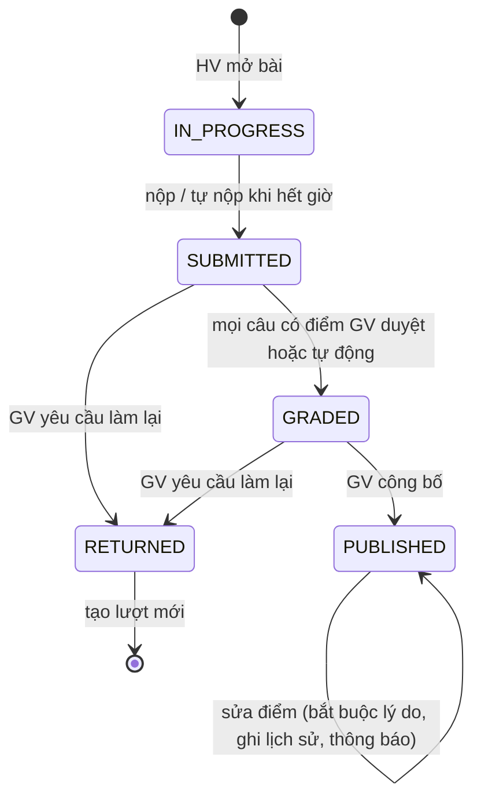

# 08 · Homework & Assessment – Đặc tả nghiệp vụ

> Trạng thái: chờ review · Phase 2 (chấm AI: Phase 3).
> Tài liệu này **thay thế** bộ Homework Management System cũ (đã chuyển vào [archive](archive/homework-management-v1/README.md)). Chỉ giữ những gì phù hợp với trung tâm tiếng Hàn; phần không phù hợp đã bỏ (xem §9).

---

## 1. Phạm vi

Giáo viên giao bài theo bài giáo trình → học viên làm, nộp → hệ thống chấm phần xác định → giáo viên chấm phần còn lại, duyệt, công bố → học viên và **phụ huynh** xem kết quả.

Hai loại trong MVP (cùng một engine, khác cài đặt):

| Loại | Khác biệt | Mức |
|---|---|---|
| **Bài tập** | Làm ở nhà, có hạn nộp, có thể cho làm nhiều lần, có thể cho xem giải thích sau khi nộp | P0 |
| **Kiểm tra** | Có giới hạn thời gian, một lần làm, **không gợi ý/không AI/không đáp án** trong lúc làm | P1 |

Luyện tập tự do trong bài học (không giao, không công bố điểm) thuộc module Learning Progress. Thi thử TOPIK/KIIP thuộc Phase 5.

---

## 2. Dạng câu hỏi

| Dạng | Chấm | Mức |
|---|---|---|
| Một đáp án | Tự động | P0 |
| Nhiều đáp án (đúng hết / điểm từng phần) | Tự động | P0 |
| Đúng/Sai | Tự động | P0 |
| Điền từ (một hoặc nhiều chỗ trống) | Tự động – so khớp chuẩn hóa tiếng Hàn | P0 |
| Trả lời ngắn | Tự động theo danh sách đáp án chấp nhận; nếu không khớp → GV xem | P0 |
| Viết / tự luận | GV (P3: AI đề xuất) | P0 |
| Dịch Việt–Hàn / Hàn–Việt | GV, có đáp án tham khảo (P3: AI đề xuất) | P0 |
| Ghi âm | GV nghe và chấm | P0 |
| Ghép nối | Tự động | P1 |
| Sắp xếp (từ thành câu, câu thành đoạn) | Tự động | P1 |
| Nộp file (ảnh bài viết tay, tài liệu) | GV | P1 |

Một bài có thể **trộn** nhiều dạng (đáp ứng "dạng kết hợp" – không phải một dạng riêng).

**So khớp đáp án tiếng Hàn:** chuẩn hóa Unicode NFC, bỏ khoảng trắng đầu/cuối và trùng lặp; tùy chọn theo câu hỏi: *bỏ qua khoảng cách từ*, *bỏ qua dấu câu*. Khi bỏ qua khoảng cách từ mà học viên viết sai khoảng cách → vẫn đúng, nhưng ghi nhận lỗi "khoảng cách từ" vào sổ tay lỗi.

---

## 3. Cài đặt bài

| Trường | Mặc định | Mức |
|---|---|---|
| Tên, hướng dẫn | — | P0 |
| Bài giáo trình liên quan (giáo trình/cấp độ/bài lấy từ lớp) | Bài đang dạy của lớp | P0 |
| Kỹ năng | Suy ra từ câu hỏi | P0 |
| Đối tượng: lớp / nhiều lớp / từng học viên | Lớp hiện tại | P0 (nhóm: P2) |
| Ngày giao | Ngay khi giao | P0 (hẹn giờ giao: P1) |
| Hạn nộp | Bắt buộc | P0 |
| Cho phép nộp muộn | Có | P0 |
| Đóng bài lúc (sau đó không nhận bài) | Không đặt = nhận đến khi GV đóng | P1 |
| Số lần làm | 1 | P0 |
| Thời lượng (phút) | Không giới hạn (Kiểm tra: bắt buộc) | P1 |
| Hiển thị đáp án | Sau khi công bố điểm | P0 |
| Điểm từng câu | 1 | P0; tổng điểm = tổng các câu |

**Đã bỏ so với bản cũ:** trừ điểm nộp muộn tự động, cách lấy điểm "cao nhất" (luôn lấy lần nộp được công bố gần nhất), xáo trộn câu hỏi (P2), chấm ẩn danh.

---

## 4. Trạng thái

### 4.1 Bài (phía giáo viên)

`Nháp → Đã giao → Đã đóng`, nhánh `Thu hồi`. "Chưa mở / Đang mở / Hết hạn" được **suy ra** từ ngày giao, hạn nộp, ngày đóng — không lưu riêng.

### 4.2 Học viên với một bài – hai chiều tách biệt

| Tình trạng làm bài | Ý nghĩa | Thấy được bởi |
|---|---|---|
| Chưa bắt đầu | Chưa mở bài | HV, GV, PH |
| Đang làm | Có bản nháp, **chưa nộp** | HV, GV, PH |
| Đã nộp | Đã nộp, chờ chấm/đã chấm nhưng chưa công bố | HV, GV, PH |
| Cần làm lại | GV trả bài, có hạn mới | HV, GV, PH |
| Đã có điểm | Điểm đã công bố | HV, GV, PH |

| Thời hạn | Ý nghĩa |
|---|---|
| Đúng hạn | Nộp trước hạn |
| Nộp muộn | Nộp sau hạn (được phép) |
| Quá hạn chưa nộp | Qua hạn, chưa nộp |

Giáo viên thấy thêm trạng thái nội bộ *Chờ chấm / Đã chấm (chưa công bố)*. Phụ huynh **không** thấy điểm chưa công bố; "Đang làm" không được hiển thị như hoàn thành.

### 4.3 Lượt làm và điểm (nội bộ)

Điểm từng câu: `Chờ chấm → Tự động | AI đề xuất (P3) → GV duyệt`. Điểm AI lưu tách biệt, chỉ thành điểm chính thức khi GV chấp nhận.

---

## 5. Quy tắc nghiệp vụ

| Mã | Quy tắc |
|---|---|
| HW-01 | GV chỉ giao bài cho lớp mình được phân công (hiệu lực tại thời điểm giao) |
| HW-02 | Bài chỉ giao được khi có ≥ 1 câu, câu tự động có đáp án, hạn nộp sau ngày giao |
| HW-03 | Danh sách người nhận chốt khi giao; HV ghi danh sau đó nhận bài nếu bài chưa hết hạn; một HV chỉ nhận một lần dù thuộc nhiều đối tượng |
| HW-04 | Khi giao, câu hỏi được **khóa ở phiên bản hiện tại**; sửa câu hỏi gốc không ảnh hưởng bài đã giao |
| HW-05 | Mọi thời điểm (bắt đầu, nộp, hết giờ) theo đồng hồ server; hạn hiển thị theo múi giờ cơ sở |
| HW-06 | Tự lưu nháp (server + bản cục bộ khi mất mạng); nộp có khóa idempotent → bấm nhiều lần chỉ tạo một bài nộp |
| HW-07 | Bài đã nộp là **bất biến**; nộp lại tạo lượt mới, không ghi đè |
| HW-08 | Nộp sau hạn: nếu cho phép → đánh dấu *Nộp muộn* (chốt tại thời điểm nộp, không đổi khi GV sửa hạn sau); nếu không → từ chối |
| HW-09 | Chấm tự động ngay khi nộp; kết quả tự động chỉ hiện cho HV khi công bố (bài *Luyện tập* trong bài học thì hiện ngay) |
| HW-10 | Công bố khi mọi câu đã có điểm duyệt; công bố theo từng HV hoặc cả lớp |
| HW-11 | Mọi thay đổi điểm ghi lịch sử (ai, khi nào, cũ/mới, lý do); sửa sau công bố bắt buộc lý do và thông báo HV/PH |
| HW-12 | Đáp án/giải thích không bao giờ có trong dữ liệu gửi HV trước thời điểm được phép (kiểm tra ở backend) |
| HW-13 | Kiểm tra: một lần làm, có giờ; AI Tutor và giải thích bị chặn ở backend cho đến khi nộp |
| HW-14 | Sửa bài đã giao khi đã có bài nộp: chỉ sửa hướng dẫn, hạn nộp; sửa đáp án → hệ thống chấm lại tự động mọi lượt, ghi lịch sử, thông báo nếu điểm công bố thay đổi |
| HW-15 | Thu hồi bài: HV/PH không thấy nữa; bài nộp được giữ; khôi phục được |
| HW-16 | GV có thể gia hạn riêng cho từng HV |
| HW-17 | HV chuyển lớp/bảo lưu: bài đang mở ở lớp cũ vẫn nộp được đến hạn, không nhận bài mới (chờ D-B11) |
| HW-18 | Câu sai sau khi công bố (hoặc ngay trong luyện tập) → ghi vào sổ tay lỗi của HV |

---

## 6. Phụ huynh xem bài tập (Phase 2 – theo D-B15 đã duyệt)

Ngay khi chức năng giao bài chạy, phụ huynh thấy trên trang con mình:

- Danh sách bài: tên, giáo viên, ngày giao, hạn nộp, tình trạng làm bài, thời hạn, thời điểm nộp.
- Điểm và nhận xét **chỉ khi đã công bố**.
- Tóm tắt: số bài giao / đã nộp / chưa làm / quá hạn.

Phụ huynh không mở được nội dung câu hỏi hay bài làm (tránh làm thay); không thấy đáp án.

---

## 7. Thông báo (in-app, Phase 2)

| Sự kiện | Học viên | Phụ huynh | Giáo viên |
|---|---|---|---|
| Bài mới | ✔ | ✔ | — |
| Sắp đến hạn (24h trước, chưa nộp) | ✔ | ✔ | — |
| Quá hạn chưa nộp | ✔ | ✔ | Tổng hợp theo bài |
| Đã nộp | — | ✔ | Gộp theo bài |
| Cần làm lại | ✔ | ✔ | — |
| Đã có điểm | ✔ | ✔ | — |

---

## 8. Ngoại lệ (giữ từ bản cũ, đã điều chỉnh)

| # | Tình huống | Xử lý |
|---|---|---|
| E01 | Bấm nộp nhiều lần / mạng gửi lại | Khóa idempotent + ràng buộc duy nhất → một bài nộp |
| E02 | Nộp sau hạn | HW-08; thông báo lỗi rõ |
| E03 | Hết giờ khi mất mạng | Tự nộp bản nháp mới nhất trên server; client báo phần chưa đồng bộ |
| E04 | Mở bài trên hai thiết bị | Nháp có số phiên bản; xung đột → cảnh báo, giữ bản mới nhất |
| E05 | Đồng hồ máy HV sai | Đếm ngược theo thời gian server trả về |
| E06 | AI lỗi/timeout/vượt hạn mức (P3) | Retry → thất bại thì GV chấm tay; bài nộp không ảnh hưởng |
| E07 | AI trả kết quả sai cấu trúc/điểm vượt mức (P3) | Loại bỏ, retry 1 lần, rồi chấm tay |
| E08 | Bài làm chứa câu lệnh nhằm thao túng AI (P3) | Coi là dữ liệu; gắn cờ cho GV |
| E09 | File sai định dạng/quá lớn/ghi âm lỗi | Kiểm tra định dạng thật và dung lượng ở server; cho ghi lại trước khi nộp |
| E10 | HV/PH đổi ID trên URL để xem bài người khác | 404, ghi log bảo mật |
| E11 | GV bị gỡ khỏi lớp khi đang chấm | Request tiếp theo bị từ chối; điểm đã lưu được giữ |
| E12 | Hai GV cùng chấm một bài | Khóa lạc quan; người lưu sau được cảnh báo |
| E13 | Cả lớp nộp sát hạn | Nộp chỉ ghi DB + đưa việc chấm vào hàng đợi |
| E14 | File upload nhưng không nộp | Dọn sau 24h |

---

## 9. Những gì đã bỏ khỏi bản Homework cũ

| Nội dung cũ | Lý do bỏ / thay |
|---|---|
| Năm học, học kỳ, môn học, phân công theo môn | Trung tâm tổ chức theo lớp + giáo trình; phân công theo lớp |
| Một trường duy nhất | Multi-tenant (đã duyệt) |
| Admin trường xem toàn bộ bài | Center Admin xem trong trung tâm; Super Admin chỉ hỗ trợ có audit |
| Soạn công thức toán (KaTeX) | Không cần cho tiếng Hàn |
| Sao chép câu hỏi khi tái sử dụng | Thay bằng phiên bản câu hỏi bất biến (HW-04) |
| Trừ điểm muộn tự động, điểm "cao nhất", chấm ẩn danh | Không cần thiết cho vận hành trung tâm; giảm khái niệm |
| Ngân sách AI theo giáo viên | Hạn mức theo trung tâm/gói (đơn giản hơn) |
| Quét virus ClamAV ngay MVP | P2; MVP kiểm tra định dạng thật + bucket riêng tư |
| Phụ huynh = LATER | Phụ huynh từ Phase 1; xem bài tập từ Phase 2 |
| Model AI cụ thể ghi trong tài liệu | Nhà cung cấp/model chọn qua đánh giá ở Phase 3 (D-T06) |
